# ANKI ENGINEERING AUDIT — Engenharia reversa do Anki e especificação do **Stazia Recall**

> **Documento:** auditoria técnica + especificação de produto/engenharia
> **Alvo da análise:** Anki (código-fonte oficial `ankitects/anki`), versão `26.09.3`, commit `d64812b6` (2026-10-09)
> **Produto a construir:** **Stazia Recall** — módulo de repetição espaçada do **StaziaMed Revalida** (Next.js + TypeScript + Supabase + PostgreSQL)
> **Data:** 2026-10-12
> **Idioma:** Português (termos técnicos e identificadores mantidos em inglês)

---

## Sumário

0. [Sumário executivo](#0-sumário-executivo)
1. [Escopo, fonte e metodologia](#1-escopo-fonte-e-metodologia)
2. [Licenciamento e estratégia clean-room](#2-licenciamento-e-estratégia-clean-room)
3. [Arquitetura do Anki (Rust, Python, TypeScript)](#3-arquitetura-do-anki)
4. [Banco de dados SQLite e modelo de entidades](#4-banco-de-dados-sqlite-e-modelo-de-entidades)
5. [Algoritmos de agendamento: SM-2 (variante Anki) e FSRS](#5-algoritmos-de-agendamento)
6. [Sistema de filas (queue v3)](#6-sistema-de-filas-queue-v3)
7. [Histórico de revisões (revlog)](#7-histórico-de-revisões-revlog)
8. [Sincronização e funcionamento offline](#8-sincronização-e-funcionamento-offline)
9. [Importação e exportação (APKG/COLPKG/CSV)](#9-importação-e-exportação)
10. [Interface de estudo](#10-interface-de-estudo)
11. [Estatísticas de aprendizagem](#11-estatísticas-de-aprendizagem)
12. [Instruções de desenvolvimento, dependências e execução de testes](#12-instruções-de-desenvolvimento-dependências-e-testes)
13. [Stazia Recall — arquitetura alvo](#13-stazia-recall--arquitetura-alvo)
14. [Stazia Recall — modelo de dados PostgreSQL](#14-stazia-recall--modelo-de-dados-postgresql)
15. [Stazia Recall — motor de agendamento](#15-stazia-recall--motor-de-agendamento)
16. [Stazia Recall — contratos de API](#16-stazia-recall--contratos-de-api)
17. [Stazia Recall — offline e sincronização](#17-stazia-recall--offline-e-sincronização)
18. [Stazia Recall — importação APKG](#18-stazia-recall--importação-apkg)
19. [Stazia Recall — interface e integração com o Revalida](#19-stazia-recall--interface-e-integração-com-o-revalida)
20. [Stazia Recall — estatísticas](#20-stazia-recall--estatísticas)
21. [Plano de implementação](#21-plano-de-implementação)
22. [Estratégia de testes](#22-estratégia-de-testes)
23. [Riscos, decisões e questões em aberto](#23-riscos-decisões-e-questões-em-aberto)
- [Apêndice A — Mapa Anki → Stazia Recall](#apêndice-a--mapa-anki--stazia-recall)
- [Apêndice B — Glossário](#apêndice-b--glossário)

---

## 0. Sumário executivo

**O que o Anki é, tecnicamente.** Um aplicativo *local-first* cujo núcleo (≈88 mil linhas de Rust em `rslib/`) concentra todo o domínio: armazenamento SQLite, agendamento (SM-2 e FSRS), filas, busca, renderização de templates, importação/exportação e sincronização. Python (`pylib/`, `qt/aqt/`) é uma casca de GUI PyQt6 e uma API para add-ons; TypeScript/Svelte (`ts/`) implementa as telas modernas (opções de baralho, editor, gráficos), que conversam com o Rust via **Protobuf sobre HTTP POST local**. O contrato entre camadas é definido em 25 arquivos `.proto` (~269 RPCs).

**Os 7 pontos mais importantes para o Stazia Recall:**

1. **Licença:** o Anki é **AGPL-3.0-or-later**. Nenhum trecho de código do Anki pode ser copiado para um SaaS proprietário. Este documento descreve *comportamentos, formatos e fórmulas* (fatos e ideias, não expressão) e propõe uma implementação **clean-room**.
2. **FSRS é separável:** o algoritmo FSRS vem do crate `fsrs` 6.6.2 (**BSD-3-Clause**, Open Spaced Repetition), não do código AGPL. Para TypeScript existe `ts-fsrs` 5.4.2 (**MIT**, mesmo grupo) — é a base recomendada para o motor do Stazia Recall.
3. **Estado do cartão = (tipo, fila, due, intervalo, memória S/D)** + **log imutável de revisões**. O revlog é a fonte de verdade para recomputar a memória FSRS, otimizar parâmetros e gerar estatísticas. O Stazia Recall deve adotar o mesmo princípio (*event-sourced light*).
4. **Filas são derivadas, não persistidas:** o Anki reconstrói a fila do dia a partir de consultas SQL (aprendizado intradiário → aprendizado interdia → revisões → novos), aplicando limites hierárquicos por baralho. Em PostgreSQL isso vira uma função/consulta indexada por `(user_id, due_at)`.
5. **Sincronização baseada em USN** (`usn = -1` = pendente) com regra *last-writer-wins por mtime*, *delete-wins* via tabela `graves`, e *append-only* para o revlog. Para um SaaS com Supabase, a recomendação é um **outbox de eventos idempotentes** (revisões com UUID gerado no cliente) — mais simples e mais robusto que replicar o protocolo do Anki.
6. **APKG é um ZIP com um banco SQLite** (legado `collection.anki2/anki21`, ou `collection.anki21b` comprimido com zstd + manifesto protobuf de mídia). Pode ser lido por implementação própria usando `fflate` (MIT), `fzstd` (MIT) e `sql.js` (MIT) — o formato é interoperável; o código de leitura deve ser escrito do zero.
7. **Integração com o Revalida** é o diferencial: questões erradas geram cartões automaticamente, cartões são etiquetados pela taxonomia do Revalida (grande área → especialidade → tema), e as métricas de retenção alimentam o plano de estudos.

**Resultado da execução de testes:** ver [§12.4](#124-execução-dos-testes-oficiais).

---

## 1. Escopo, fonte e metodologia

### 1.1 Situação do repositório de trabalho

O repositório `araujomendes89-collab/engenhariaanki` (branch `claude/busy-maxwell-s1af9b`) estava **vazio** (sem commits, sem código do Anki) no início da auditoria. Para cumprir o objetivo sem modificar nem redistribuir o código original:

- O código oficial foi clonado **somente para leitura** em um diretório temporário fora do repositório (`git clone --depth 1 https://github.com/ankitects/anki.git`).
- Nenhum arquivo do Anki foi adicionado a este repositório. O único artefato versionado é este documento.
- **Referência exata:** commit `d64812b680426c6dd55f9de7004070e560361d4b` — "fix: Replace internal redirects with new docs locations (#5777)" — versão `.version` = `26.09.3`.

### 1.2 Tamanho do código analisado

| Linguagem | Arquivos | Linhas |
|---|---:|---:|
| Rust (`.rs`) | 407 | 87.715 |
| Python (`.py`) | 252 | 53.599 |
| TypeScript (`.ts`) | 267 | 22.607 |
| Svelte (`.svelte`) | 250 | 22.447 |
| Protobuf (`.proto`) | 25 | 3.497 |
| SQL (`.sql`) | 112 | 1.316 |
| SCSS | 42 | 2.488 |

### 1.3 Metodologia

1. Leitura das instruções oficiais (`CLAUDE.md`/`AGENTS.md`, `docs/development.md`, `docs/build.md`, `docs/architecture.md`, `docs/unit-testing.md`, `justfile`).
2. Varredura dirigida por subsistema (arquitetura, agendamento/FSRS, modelo de dados, sync/APKG, UI/estatísticas), sempre citando o caminho do arquivo-fonte.
3. Conferência das fórmulas do FSRS contra o crate `fsrs` v6.6.2 (BSD-3), que é a dependência efetivamente usada.
4. Instalação do toolchain oficial (Rust 1.99.0 via `rust-toolchain.toml`, `just`) e execução dos testes oficiais (`just test-rust`, etc.).
5. Redação da especificação do Stazia Recall **sem reutilizar código**: apenas requisitos, formatos de arquivo (para interoperabilidade) e fórmulas publicadas.

> Convenção: caminhos `rslib/...`, `pylib/...`, `qt/...`, `ts/...`, `proto/...` são relativos à raiz do repositório do Anki.

---

## 2. Licenciamento e estratégia clean-room

### 2.1 Licenças relevantes

| Componente | Licença | Implicação para SaaS proprietário |
|---|---|---|
| Anki (rslib, pylib, qt, ts, proto) | **AGPL-3.0-or-later** (contribuições de usuários também BSD-3, ver `CONTRIBUTORS`) | **Proibido copiar/derivar código.** A AGPL obriga a disponibilizar o código-fonte de serviços de rede que usem código derivado. |
| `pylib/anki/statsbg.py` | CC BY 4.0 | Não usar. |
| Crate `fsrs` 6.6.2 (`open-spaced-repetition/fsrs-rs`) | **BSD-3-Clause** | Uso permitido com atribuição. |
| `ts-fsrs` 5.4.2 (npm) | **MIT** | **Recomendado** como motor FSRS do Stazia Recall. |
| `fflate` 0.8.3, `fzstd` 0.1.1, `sql.js` 1.14.2 | MIT | Leitura de APKG. |
| Logotipo e marca "Anki" | AGPL + licença restrita | Não usar marca/logotipo; usar "compatível com arquivos .apkg". |

### 2.2 Regras clean-room adotadas para o Stazia Recall

1. **Separação de papéis:** este documento é a "especificação". A equipe que implementa o Stazia Recall trabalha a partir dele e de fontes públicas (paper/wiki do FSRS, documentação do `ts-fsrs`), **sem abrir o código-fonte do Anki** durante a implementação.
2. **Nada de copiar:** nenhum SQL, CSS, template, string de tradução (`ftl/`), regex ou função do Anki. Nomes de colunas do formato APKG são usados **apenas no leitor de importação**, por necessidade de interoperabilidade.
3. **Algoritmos são ideias:** SM-2 (Woźniak, 1987) e FSRS (Ye et al., publicado) são algoritmos públicos; constantes padrão (ex.: ease inicial 2,5, parâmetros FSRS padrão) são fatos numéricos. Ainda assim, a recomendação é **usar `ts-fsrs` (MIT) e não portar** a lógica de agendamento do Anki.
4. **Conteúdo de terceiros:** baralhos `.apkg` importados pertencem aos usuários/autores. O Stazia Recall deve tratá-los como conteúdo privado do usuário (sem redistribuição), e os termos de uso devem refletir isso.
5. **Registro:** manter um `THIRD_PARTY_NOTICES.md` no produto com as licenças MIT/BSD/Apache das dependências.

> ⚠️ Este documento não constitui parecer jurídico. Recomenda-se revisão por advogado de propriedade intelectual antes do lançamento, especialmente sobre a importação de `.apkg` e uso da expressão "compatível com Anki".

---

## 3. Arquitetura do Anki

### 3.1 Visão em camadas

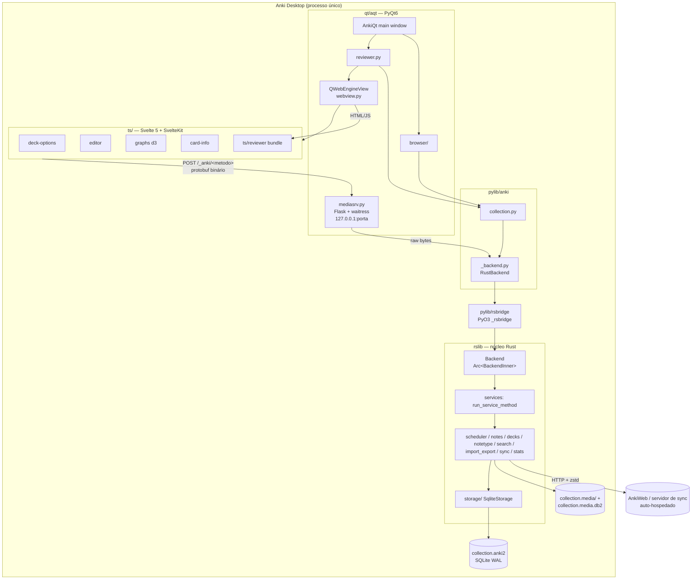

### 3.2 Núcleo Rust (`rslib/src`)

| Módulo | Arquivos/linhas | Responsabilidade |
|---|---|---|
| `scheduler/` | 61 / 13.712 | Respostas, estados, FSRS (memória, parâmetros, simulador, retenção), filas, timing, enterrar/suspender, baralhos filtrados |
| `import_export/` | 26 / 7.417 | `.apkg`, `.colpkg`, CSV/JSON, mídia |
| `sync/` | 55 / 8.089 | Sync de coleção e mídia, cliente HTTP, servidor HTTP (axum) |
| `storage/` | 18 / 5.503 | Camada SQLite, SQL por entidade, upgrades de schema |
| `notetype/` | 15 / 5.204 | Tipos de nota, geração de cartões, cloze, mudança de schema |
| `search/` | 8 / 5.188 | Parser de busca (nom) e gerador de SQL |
| `decks/` | 14 / 3.706 | Árvore de baralhos, contagens, limites, filtrados |
| `deckconfig/` | 5 / 2.615 | Presets de opções (inclui FSRS) |
| `media/` | 4 / 2.171 | Pasta de mídia, checagem |
| `tags/` | 13 / 1.992 | Hierarquia de tags |
| `notes/` | 3 / 1.898 | Notas |
| `card_rendering/` | 7 / 1.679 | Renderização, tags de áudio/TTS |
| `stats/` | 16 / 1.168 | Gráficos, card info, "hoje" |
| `undo/` | 2 / 664 | Desfazer/refazer |
| `backend/` | 16 / 1.813 | `Backend` e serviços que não exigem coleção aberta |

Arquivos de topo relevantes: `template.rs` e `template_filters.rs` (motor de templates), `cloze.rs`, `typeanswer.rs`, `browser_table.rs`, `dbcheck.rs`, `findreplace.rs`, `latex.rs`, `markdown.rs`.

### 3.3 Protobuf como contrato entre linguagens

- 25 arquivos em `proto/anki/`. Cada domínio define um par `XService` (opera sobre a coleção aberta) e `BackendXService` (opera sem coleção).
- `rslib/proto_gen/src/lib.rs` (`get_services()`) indexa serviços e métodos com índices numéricos estáveis; `rslib/build.rs` gera `Backend::run_service_method(service: u32, method: u32, input: &[u8])`.
- Métodos de coleção são encaminhados automaticamente com `self.with_col(|col| …)` — ou seja, **toda operação de coleção é serializada por um `Mutex<Option<Collection>>`**.
- Geração para Python (`out/pylib/anki/_backend_generated.py`, métodos snake_case + variante `_raw`) e TypeScript (`out/ts/lib/generated/backend.ts`, via `@bufbuild/protobuf`).
- Maiores serviços: scheduler (41 RPCs), frontend (29), decks (26), notetypes (21), card_rendering (19), collection (18).

### 3.4 Python (`pylib/`) e GUI (`qt/aqt/`)

- `pylib/rsbridge/lib.rs`: extensão PyO3 que expõe `Backend.command(service, method, bytes)` e `db_command(bytes)`, **liberando o GIL** durante a chamada.
- `pylib/anki/_backend.py`: converte `BackendError` em exceções Python e alerta quando uma chamada bloqueia a thread principal por >200 ms.
- `pylib/anki/collection.py`: fachada `Collection` (cards, notes, decks, models, tags, sched, media, db).
- `qt/aqt/mediasrv.py`: servidor Flask/waitress em `127.0.0.1`. `POST /_anki/<metodoCamelCase>` é atendido por handlers Python ou encaminhado em bytes crus ao Rust (lista branca de ~60 RPCs). Segurança: `Content-Type: application/binary` obrigatório; páginas confiáveis recebem `Authorization: Bearer <token aleatório>`; o revisor (conteúdo potencialmente não confiável do usuário) só pode chamar 4 endpoints.
- Concorrência na GUI: `aqt/taskman.py` usa um `ThreadPoolExecutor(max_workers=1)` para operações de coleção; `CollectionOp`/`QueryOp` executam em segundo plano e disparam `on_op_finished` com `OpChanges` para atualizar telas.

### 3.5 TypeScript/Svelte (`ts/`)

- SvelteKit (adapter-static) servido em `/_anki/pages/`: `deck-options` (41 arquivos, inclui UI do FSRS e simulador), `editor` (89), `graphs` (53, d3), `image-occlusion` (54, fabric.js), `card-info`, `congrats`, `import-*`, `change-notetype`, `preferences`.
- O **revisor não é SvelteKit**: é Python + bundle em `ts/reviewer/` (injeção de HTML, MathJax sob demanda, pré-carga de imagens).
- Chamada ao backend: `postProto(method, input, Output)` → `fetch('/_anki/'+method, {method:'POST', headers:{'Content-Type':'application/binary'}, body: bytes})`.

### 3.6 Transações, operações e progresso

- `Collection::transact()` (`collection/transact.rs`): abre savepoint `rust`, registra passo de undo, aplica mudanças, atualiza `col.mod`, faz commit e retorna `OpOutput { changes: OpChanges }`. A UI usa `OpChanges` (ex.: `study_queues`, `note_text`, `card`) para decidir o que redesenhar.
- Progresso: `ThrottlingProgressHandler` publica no máximo a cada 100 ms; a UI faz polling via `latest_progress`; cancelamento via `SetWantsAbort`.

**Lição para o Stazia Recall:** concentrar **todo** o domínio em uma camada única (aqui: pacote TypeScript `@stazia/recall-core` + funções PostgreSQL), e fazer UI e API serem cascas finas. Retornar "o que mudou" após cada mutação (equivalente a `OpChanges`) para invalidar caches do React Query.

---

## 4. Banco de dados SQLite e modelo de entidades

### 4.1 Versões de schema

- Faixa suportada: **11 a 18** (`rslib/src/storage/upgrades/mod.rs`). 12 e 13 são rejeitadas (`FileTooNew`).
- Uma coleção nova é criada no schema 11 (`storage/schema11.sql`) e atualizada até 18 na mesma transação exclusiva.
- Marcos: **v14** cria `deck_config`, `config`, `tags` (migra JSON de `col`); **v15** cria `fields`, `templates`, `notetypes`, `decks`; **v16** normaliza `initial_ease`; **v17** reconstrói `tags` com `collapsed`/`config`; **v18** reconstrói `graves` como `WITHOUT ROWID` com PK `(oid,type)`.
- *Downgrade* para 11 (ao exportar formato legado ou sync com clientes antigos) serializa tudo de volta em JSON nas colunas de `col`.

### 4.2 Pragmas e funções SQL customizadas

- Pragmas (`storage/sqlite.rs`): `locking_mode=exclusive`, `page_size=4096`, `cache_size=-40960` (40 MB), `journal_mode=wal`; transações `begin exclusive` + savepoint.
- Funções registradas: `field_at_index`, `regexp`, `regexp_fields`, `regexp_tags`, `process_text` (remover acentos/cloze), `fnvhash`, `extract_original_position`, `extract_custom_data`, `extract_fsrs_variable` (s/d/dr), `extract_fsrs_retrievability`, `extract_fsrs_relative_retrievability`; collation `unicase`.

### 4.3 Diagrama ER (schema 18)

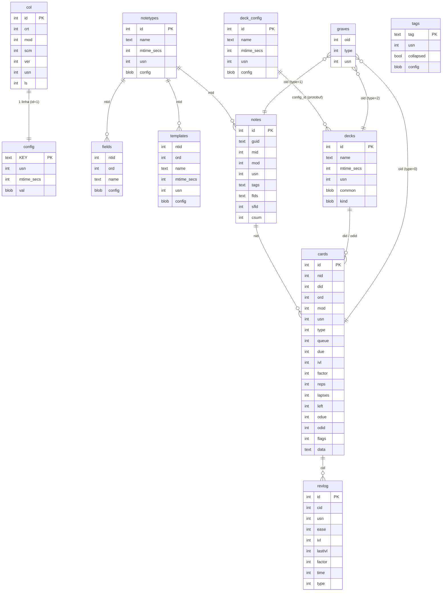

### 4.4 Tabelas principais (semântica)

**`col`** (linha única): `crt` = criação em segundos (base do "dia" das revisões); `mod`, `scm` (mudança de schema → força sync completo), `ls` (último sync) em **milissegundos**; `usn` = contador do servidor; no schema 11 também `conf/models/decks/dconf/tags` em JSON.

**`notes`**: `id` (timestamp ms), `guid` (u64 aleatório em base91 — chave de deduplicação na importação), `mid` (notetype), `mod` (s), `usn`, `tags` (`" a b "`, com espaços nas pontas), `flds` (campos unidos por `0x1F`), `sfld` (campo de ordenação; tipo `integer` de propósito para ordenar números), `csum` (primeiros 4 bytes do SHA-1 do 1º campo sem HTML — detecção rápida de duplicatas).

**`cards`** — o coração do agendamento:

| Coluna | Significado |
|---|---|
| `type` | **CardType**: 0 New, 1 Learn, 2 Review, 3 Relearn |
| `queue` | **CardQueue**: 0 New, 1 Learn (intradiário), 2 Review, 3 DayLearn (aprendizado interdia), 4 PreviewRepeat, −1 Suspended, −2 SchedBuried, −3 UserBuried |
| `due` | Depende da fila: **New** → posição; **Learn/Preview** → timestamp Unix (s); **Review/DayLearn** → número do dia desde `col.crt` |
| `ivl` | Intervalo em dias |
| `factor` | Ease ×1000 (2500 = 250%) no SM-2 |
| `left` | Passos restantes (`left % 1000`) |
| `odue`, `odid` | Due e baralho originais enquanto em baralho filtrado |
| `flags` | 3 bits baixos = bandeira 0–7 |
| `data` | JSON `CardData`: `pos` (posição original), `s` (estabilidade), `d` (dificuldade), `dr` (retenção desejada), `decay`, `lrt` (last review time, s), `cd` (custom data ≤100 bytes) |

**`revlog`**: ver §7. **`graves`**: `oid`, `type` (0 card, 1 note, 2 deck), `usn` — lápides para propagar exclusões no sync.

**`decks`**, **`deck_config`**, **`notetypes`**, **`fields`**, **`templates`** guardam a configuração como **blobs protobuf** (`proto/anki/decks.proto`, `deck_config.proto`, `notetypes.proto`), com nome indexado `COLLATE unicase` para unicidade.

### 4.5 Entidades de domínio

- **Notetype** (`rslib/src/notetype/`): tipo `NORMAL` (0) ou `CLOZE` (1); lista ordenada de campos (fonte, RTL, sticky, plain text, excluir da busca…); templates (`qfmt`, `afmt`, formatos de navegador, baralho-alvo); CSS; cabeçalho/rodapé LaTeX; `sort_field_idx`; requisitos `Any/All/None` por template.
- **Geração de cartões** (`notetype/cardgen.rs`): normal → um cartão por template que renderiza conteúdo não vazio; cloze → um cartão por número de cloze (`ord = N−1`, máx. 499).
- **Motor de templates** (`template.rs`, `template_filters.rs`): estilo Mustache. `{{Campo}}`, `{{#Campo}}…{{/Campo}}` (se não vazio), `{{^Campo}}` (se vazio), filtros encadeados `{{filtro:Campo}}` aplicados da direita para a esquerda (`text`, `cloze`, `cloze-only`, `type`, `hint`, `furigana`, `kanji`, `kana`, `tts`). Campos especiais: `FrontSide`, `Tags`, `Deck`, `Subdeck`, `Type`, `Card`, `CardFlag`, `CardID`.
- **Cloze** (`cloze.rs`): `{{c1::texto}}` ou `{{c1::texto::dica}}`, múltiplos ordinais (`{{c1,2::…}}`), aninhamento, tratamento de MathJax; renderiza `<span class="cloze">[...]</span>` no lado ativo e `cloze-inactive` nos demais.
- **Decks**: hierarquia com separador `0x1F` (exibido como `::`); `Normal` (preset, limites próprios/diários, retenção desejada por baralho) ou `Filtered` (buscas + ordem + reagendar ou não + delays de pré-visualização). Deck padrão id 1.
- **Tags**: hierarquia com `::`, case-insensitive, normalização NFC.
- **Mídia**: pasta `X.media/` + banco `X.media.db2` (`media(fname, csum sha1, mtime, dirty)`, `meta(dirMod, lastUsn)`); nomes NFC, máx. 120 bytes, máx. 100 MB por arquivo; conflito de nome → `nome-<sha1>.ext`.

### 4.6 IDs, USN e tempos

- IDs de card/note/deck/notetype/revlog = **timestamp em ms**, com `max(id)+1` em colisão.
- `usn = -1` no cliente significa "pendente de sync"; no servidor é o contador `col.usn`.
- `mod`/`mtime_secs` das entidades em **segundos**; `col.mod/scm/ls` em **ms**.

### 4.7 Busca

Parser `nom` (`search/parser.rs`) com AND implícito, `or`, negação `-`, parênteses, aspas, curingas `*`/`_`. Chaves: `deck:`, `note:`, `tag:`, `card:`, `flag:`, `is:new|review|learn|due|buried|suspended`, `prop:ivl|due|reps|lapses|ease|pos|s|d|r`, `added:`, `edited:`, `rated:N[:botão]`, `introduced:`, `re:`, `nc:`, `dupe:`, `Campo:valor`. O gerador (`sqlwriter.rs`) produz SQL sobre `cards c, notes n` e grava resultados em tabelas temporárias.

### 4.8 Desfazer

`UndoManager` com até 30 passos; cada passo guarda o estado original de cada entidade alterada (Added/Updated/Removed/GraveAdded…). Edições sucessivas da mesma nota em 60 s são coalescidas. Responder um cartão registra também a mudança na fila (`CardAnswered`) para restaurar a posição.

---

## 5. Algoritmos de agendamento

### 5.1 Máquina de estados do cartão

Fonte: `rslib/src/scheduler/states/`.

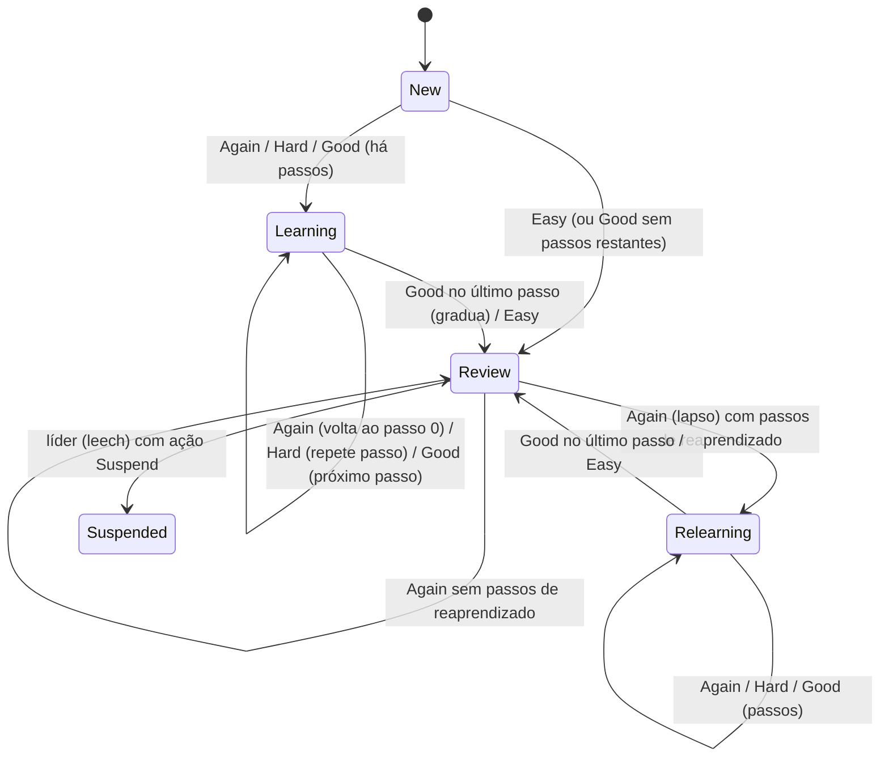

- Tipos: `New{position}`, `Learning{remaining_steps, scheduled_secs, elapsed_secs, memory_state}`, `Review{scheduled_days, elapsed_days, ease_factor, lapses, leeched, memory_state}`, `Relearning{learning, review}`; estados filtrados `Preview` e `Rescheduling`.
- Ao exibir um cartão, o backend calcula **os quatro estados seguintes** (`SchedulingStates{current, again, hard, good, easy}`) de uma vez; a UI mostra o intervalo previsto em cada botão e devolve o estado escolhido junto com a resposta. **Padrão a replicar:** o servidor calcula as previsões; o cliente nunca calcula agendamento sozinho sem a mesma biblioteca.

### 5.2 Passos de aprendizado (minutos)

Padrões: aprendizado `[1, 10]`, reaprendizado `[10]`.

- **Again** → passo 0. **Good** → próximo passo; sem próximo, gradua.
- **Hard** → repete o passo atual; no **primeiro** passo: média entre passo 0 e passo 1 (se ≥2 passos) ou `min(1,5 × passo0, passo0 + 1 dia)` (se 1 passo).
- **Easy** → gradua imediatamente.
- Graduação SM-2: Good → `graduating_interval_good` (1 dia); Easy → `graduating_interval_easy` (4 dias). Com FSRS, o intervalo de graduação vem do modelo.
- Passos de aprendizado recebem um pequeno *fuzz* aleatório: +0 a min(25%, 300 s).

### 5.3 SM-2 (variante do Anki) — revisão

Constantes: ease inicial **2,5**; ease mínima **1,3**; deltas de ease: Again −0,20, Hard −0,15, Good 0, Easy +0,15.
Notação: `I = max(intervalo_agendado, 1)`, `L = max(dias_de_atraso, 0)`, `E = ease`, `m = interval_multiplier` (1,0), `h = hard_multiplier` (1,2), `e = easy_multiplier` (1,3).

| Botão | Novo intervalo (antes de fuzz e limites) | Mínimo |
|---|---|---|
| Hard | `I × h × m` | `I + 1` (ou 0 se `h ≤ 1`) |
| Good | `(I + L/2) × E × m` | `Hard + 1` |
| Easy | `(I + L) × E × e × m` | `Good + 1` |
| Again | `max(I × lapse_multiplier, minimum_lapse_interval)` — padrão 0,0 e 1 → **1 dia** | — |

Todos limitados a `maximum_review_interval` (36.500 dias). Revisão antecipada (antes do vencimento) usa o tempo realmente decorrido em vez de `I`, sem fuzz.

**Leech:** `lapsos ≥ limiar` e `(lapsos − limiar) % ceil(limiar/2) == 0` (padrão 8 → dispara em 8, 12, 16…). Ação: apenas tag `leech` (padrão) ou suspender.

### 5.4 Fuzz (dispersão de intervalos)

Evita que cartões criados juntos vençam sempre juntos.

- Sem fuzz se intervalo < 2,5 dias.
- `delta = 1 + 0,15 × (parte do intervalo em [2,5; 7]) + 0,10 × (parte em [7; 20]) + 0,05 × (parte acima de 20)`.
- Faixa `[round(ivl − delta), round(ivl + delta)]`, limitada a `[mínimo, máximo]`. Exemplos: 7 → 5–9; 17 → 14–20; 37 → 33–41; 100 → ~92–108.
- O sorteio é **determinístico por cartão**: semente = `card_id + reps`. Isso garante que a previsão mostrada no botão seja a mesma que será aplicada.

**Load balancer** (opcional, intervalos ≤ 90 dias): dentro da faixa de fuzz, escolhe o dia com peso `(1/carga_do_dia)^2,15 × (1/ivl)^3 × modificador_irmãos × modificador_dias_fáceis`, evitando picos de carga e cartões irmãos no mesmo dia.

### 5.5 FSRS (Free Spaced Repetition Scheduler)

Integração: `rslib/src/scheduler/fsrs/` + crate `fsrs` 6.6.2 (BSD-3). Modelo de memória DSR: **D**ificuldade (1–10), **S**tabilidade (dias até R cair a 90%), **R**etrievability (probabilidade de lembrar).

**Parâmetros:** vetor `w0…w20` (FSRS-6, 21 valores). Vetores de 17 (FSRS-4.5) e 19 (FSRS-5) são convertidos. Padrões FSRS-6:

```
w = [0.212, 1.2931, 2.3065, 8.2956, 6.4133, 0.8334, 3.0194, 0.001, 1.8722, 0.1666,
     0.796, 1.4835, 0.0614, 0.2629, 1.6483, 0.6014, 1.8729, 0.5425, 0.0912, 0.0658, 0.1542]
```

**Fórmulas** (G = nota 1..4; limites S ∈ [0,001; 36.500], D ∈ [1; 10]):

| Conceito | Fórmula |
|---|---|
| Decaimento | `d = w20` (FSRS-6); `F = 0,9^(−1/d) − 1` (garante `R(S,S)=0,9`) |
| Curva de esquecimento | `R(t,S) = (1 + F·t/S)^(−d)` |
| Intervalo para retenção desejada `DR` | `I = (S/F) · (DR^(−1/d) − 1)` → com DR=0,9, `I = S` |
| Estabilidade inicial | `S0(G) = w[G−1]` |
| Dificuldade inicial | `D0(G) = w4 − e^(w5·(G−1)) + 1` |
| Atualização de dificuldade | `ΔD = −w6·(G−3)`; `D' = D + ΔD·(10−D)/9`; reversão à média `D'' = w7·D0(4) + (1−w7)·D'` |
| Estabilidade após acerto | `S' = S·(1 + e^w8 · (11−D) · S^(−w9) · (e^(w10·(1−R)) − 1) · h · b)`, `h = w15` se Hard, `b = w16` se Easy |
| Estabilidade após lapso | `S' = min( w11 · D^(−w12) · ((S+1)^w13 − 1) · e^(w14·(1−R)),  S / e^(w17·w18) )` |
| Curto prazo (mesmo dia) | `S' = S · e^(w17·(G−3+w18)) · S^(−w19)` (≥ S se G ≥ 2) |

**Uso em tempo de resposta:** obtém a memória do cartão (ou recalcula a partir do revlog), calcula dias decorridos desde `last_review_time`, chama `next_states(memória, retenção_desejada, dias)` e aplica fuzz/limites. O `interval_multiplier` **não** se aplica ao FSRS. Retenção desejada padrão **0,90** (faixa 0,70–0,99), com *override* por baralho.

**Memória a partir do histórico** (`fsrs/memory_state.rs`): percorre o revlog; ignora *cramming* (filtrado com ease 0); corta no último *reset* manual; usa intervalos inteiros em dias; se o histórico foi truncado, estima S e D a partir do intervalo e ease SM-2 do primeiro registro.

**Otimização de parâmetros** (`fsrs/params.rs`): `compute_parameters` treina com o histórico do usuário (8 épocas, batch 512, lr 0,04); um item de treino por revisão com Δt > 0; <8 itens → padrões; <64 → só S inicial; aceita novos parâmetros apenas se a *log-loss* diminuir.

**Simulador e retenção ótima** (`fsrs/simulator.rs`, `fsrs/retention.rs`): simula carga diária para DR 0,70–0,99 e minimiza custo/memorizado (Brent) em [0,70; 0,95].

### 5.6 Opções de preset (defaults)

| Opção | Padrão | Faixa |
|---|---|---|
| learn_steps | [1, 10] min | |
| relearn_steps | [10] min | |
| new_per_day / reviews_per_day | 20 / 200 | 0–9999 |
| initial_ease | 2,5 | 1,31–5 |
| easy_multiplier / hard_multiplier | 1,3 / 1,2 | 1–5 / 0,5–1,3 |
| lapse_multiplier / interval_multiplier | 0,0 / 1,0 | 0–1 / 0,5–2 |
| maximum_review_interval | 36.500 | |
| minimum_lapse_interval | 1 | |
| graduating good / easy | 1 / 4 dias | |
| leech_threshold / leech_action | 8 / TagOnly | |
| bury_new / bury_reviews / bury_interday_learning | false | |
| cap_answer_time_to_secs | 60 | |
| desired_retention | 0,90 | 0,70–0,99 |
| fsrs_params_6 | vazio (= padrões) | 21 valores |

---

## 6. Sistema de filas (queue v3)

Fonte: `rslib/src/scheduler/queue/`, `scheduler/timing.rs`, `decks/limits.rs`.

### 6.1 Dia de estudo

- Virada do dia padrão às **04:00** locais (`rollover`).
- `days_elapsed` = dias desde `col.crt` ajustados pela virada. Filas são reconstruídas quando o dia muda.
- *Learn-ahead* (`collapseTime`): 1.200 s — cartões de aprendizado que vencem nos próximos 20 min podem ser mostrados se não houver mais nada.

### 6.2 Construção da fila

```mermaid
flowchart LR
    A[Limites por baralho<br/>LimitTreeMap] --> B
    B[1. Aprendizado intradiário<br/>queue 1,4 · due ≤ fim do dia] --> C
    C[2. Aprendizado interdia<br/>queue 3 · due ≤ hoje] --> D
    D[3. Revisões<br/>queue 2 · due ≤ hoje<br/>ordem: review_order] --> E
    E[4. Novos<br/>queue 0 · gather priority + sort order] --> F
    F[Enterrar irmãos<br/>bury_new/reviews/interday] --> G
    G[Mistura<br/>interday×reviews, novos×resto<br/>Mix / Before / After] --> H[Fila principal]
    H --> I[Exibição: learning vencido agora → principal → learning 'ahead']
```

- **Limites**: revisão = override de hoje ‖ override do baralho ‖ `reviews_per_day` do preset − revisados hoje. Novos idem com `new_per_day`. Por padrão, novos também consomem o limite de revisões e `novos ≤ revisões`. Cada filho é limitado pelos pais; cada cartão coletado decrementa o baralho e todos os ancestrais.
- **Ordem de coleta de novos**: Deck (padrão), Deck→notas aleatórias, menor/maior posição, notas aleatórias, cartões aleatórios.
- **Ordem de novos**: Template (padrão), sem ordenação, template→aleatório, nota aleatória→template, cartão aleatório.
- **Ordem de revisões** (em SQL): Day (padrão), Day→Deck, Deck→Day, intervalo asc/desc, ease (ou dificuldade no FSRS), retrievability asc/desc, *relative overdueness*, aleatório, adicionados. Desempate aleatório com semente do dia.
- **Mistura**: o *Intersperser* distribui uma lista na outra com razão `(n1+1)/(n2+1)`.

### 6.3 Respondendo um cartão

`answer_card` (`scheduler/answering/mod.rs`): verifica que o estado atual não mudou (proteção contra corrida), aplica o novo estado (`type`, `queue`, `due` em dias ou timestamp; intervalos em segundos que cruzam a virada viram dias), limita o tempo de resposta a 60 s, grava revlog, atualiza estatísticas do baralho ("estudados hoje"), enterra irmãos, aplica leech, define `last_review_time`, atualiza a fila em memória e o *load balancer*. Tudo em uma transação com passo de *undo*.

---

## 7. Histórico de revisões (revlog)

| Coluna | Significado |
|---|---|
| `id` | Timestamp ms da resposta (chave primária, também usado como data) |
| `cid` | Card |
| `usn` | Sync |
| `ease` | Botão 1–4; 0 = manual/reagendado |
| `ivl` / `lastIvl` | Intervalo novo/anterior: >0 dias, <0 **segundos** |
| `factor` | Ease ×1000; no FSRS armazena dificuldade normalizada `((D−1)/9 + 0,1) × 1000` (100–1100) |
| `time` | Tempo de resposta em ms (limitado pelo cap) |
| `type` | 0 Learning, 1 Review, 2 Relearning, 3 Filtered, 4 Manual, 5 Rescheduled |

Propriedades-chave: **append-only** (no sync é `INSERT OR IGNORE`); é a fonte para (a) recomputar memória FSRS, (b) treinar parâmetros, (c) todas as estatísticas. Revisões "Manual" com ease 0 (reset/esquecer) funcionam como corte do histórico para o FSRS; *cramming* (Filtered, ease 0) é ignorado pelo FSRS.

---

## 8. Sincronização e funcionamento offline

### 8.1 Modelo offline

- **Local-first:** toda edição local grava `usn = -1`. O app funciona 100% offline; o sync é uma reconciliação posterior.
- Estado offline (`sync/collection/status.rs`): nunca sincronizou → NoChanges; `scm > ls` → FullSync; `mod > ls` → NormalSync.

### 8.2 Protocolo de sync normal

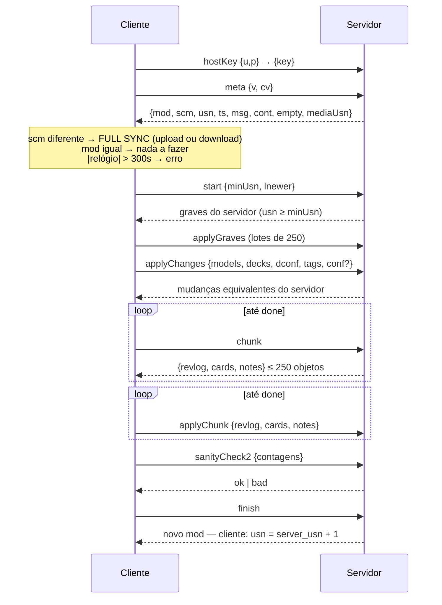

- Transporte: POST `/sync/<método>`, corpo zstd, cabeçalho `anki-sync: {"v":11,"k":hostkey,"c":versão,"s":sessão}`; limite padrão 100 MiB comprimido.
- **Resolução de conflitos:** exclusões (graves) sempre vencem; notetypes/decks/configs → maior `mtime` vence (empate: lado que chega); cards/notes → aplica remoto se o local não está pendente ou se o `mtime` remoto é estritamente maior; **revlog é união** (`INSERT OR IGNORE`); tags são união; `conf` vem do lado com `mod` mais novo.
- Mudança de schema (campos/templates de notetype, remoção de preset, reset de agendador, sanity check falho) altera `scm` e **força sync completo** (upload ou download de todo o arquivo SQLite).
- **Mídia**: protocolo separado (`/msync/begin|mediaChanges|uploadChanges|downloadFiles|mediaSanity`), lotes ZIP de até 25 arquivos/~2,5 MiB, SHA-1 por arquivo, servidor vence em conflito de conteúdo.
- Servidor auto-hospedado: `anki-sync-server` (axum), configurado por variáveis `SYNC_*`.

**Lição:** o protocolo é robusto mas complexo porque replica uma base SQLite inteira entre pares. Em um SaaS com PostgreSQL como fonte de verdade, o cliente só precisa de **cache + fila de eventos**. Ver §17.

---

## 9. Importação e exportação

### 9.1 Versões de pacote

| Versão | Arquivo de coleção | Schema | Compressão | Mapa de mídia |
|---|---|---|---|---|
| Legacy 1 | `collection.anki2` | 11 | nenhuma | JSON `{"0":"nome.jpg"}` |
| Legacy 2 | `collection.anki21` | 11 | nenhuma | JSON |
| Latest (3) | `collection.anki21b` | 18 | **zstd** | protobuf `MediaEntries` (zstd) |

### 9.2 Estrutura do ZIP `.apkg`

```
arquivo.apkg (ZIP)
├── meta                 # protobuf PackageMetadata {version} (ausente em pacotes antigos)
├── collection.anki21b   # SQLite schema 18 comprimido com zstd (versão 3)
├── collection.anki2     # em pacotes novos: coleção "dummy" pedindo atualização
├── media                # mapa índice→nome (JSON legado ou protobuf zstd)
├── 0                    # arquivos de mídia numerados (zstd na versão 3)
├── 1
└── ...
```

Protobuf do manifesto de mídia (versão 3): `MediaEntries { repeated MediaEntry entries = 1; }`, `MediaEntry { string name = 1; uint32 size = 2; bytes sha1 = 3; optional uint32 legacy_zip_filename = 255; }`; o índice da entrada é o nome do arquivo no ZIP. `PackageMetadata { Version version = 1; }`.

### 9.3 Exportação `.apkg`

Escopo: coleção, baralho, notas ou cartões. Opções: com/sem agendamento, com/sem presets, com/sem mídia, legado. **Sem agendamento**: cartões resetados para novos, bandeiras e tags `marked`/`leech` removidas, revlog excluído, filtrados viram normais. Mídia coletada das referências nos campos (``, `[sound:]`), LaTeX e arquivos `_*` dos templates.

### 9.4 Importação `.apkg`

1. Extrai e abre a coleção temporária; corrige IDs inválidos.
2. **Mídia**: compara SHA-1 com a do destino; mesmo nome e conteúdo diferente → renomeia com sufixo de hash e reescreve referências.
3. **Notetypes**: casados por ID; se o schema (campos/templates) diverge, cria cópia (ou funde, se `merge_notetypes`).
4. **Notas**: deduplicadas por **`guid`**; atualização conforme `UpdateCondition` (IF_NEWER, ALWAYS, NEVER).
5. **Decks**: casados por nome; conflitos de tipo renomeados.
6. **Cartões**: adicionados se `(nid, ord)` não existir; `due` deslocado pela diferença de dias entre coleções; revlog importado se houver agendamento.
7. Resultado: log com novas, atualizadas, duplicadas, conflitantes.

### 9.5 CSV/TXT

Cabeçalhos `#separator:`, `#html:`, `#tags:`, `#columns:`, `#notetype:`, `#deck:`, `#notetype column:`, `#deck column:`, `#tags column:`, `#guid column:`, `#match scope:`, `#if matches:`. Sem cabeçalho, detecta separador e HTML. Duplicatas por guid ou por checksum do primeiro campo.

---

## 10. Interface de estudo

### 10.1 Fluxo do revisor (`qt/aqt/reviewer.py` + `ts/reviewer/`)

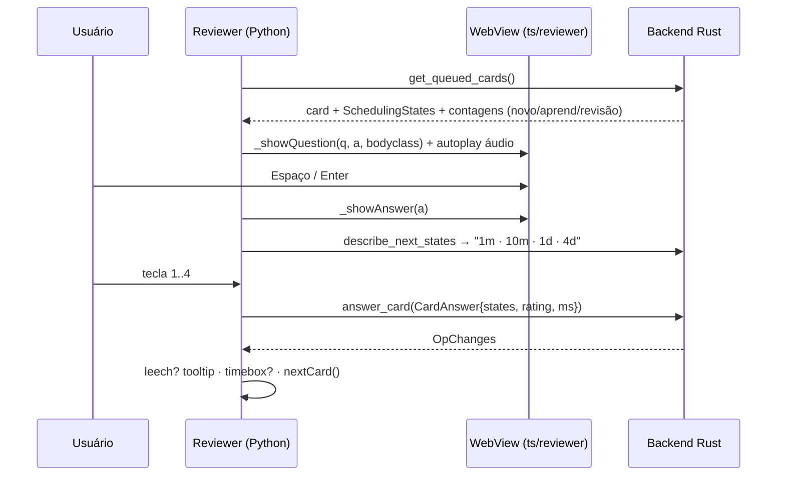

- Atalhos: `1–4` responder, Espaço/Enter mostrar/Good, `u` desfazer, `e` editar, `*` marcar, `-`/`=` enterrar cartão/nota, `@`/`!` suspender cartão/nota, Ctrl+1..7 bandeiras, `r` reproduzir áudio, `i` info do cartão, `o` opções.
- Barra inferior: contadores Novo/Aprendizado/Revisão (sublinha a fila do cartão atual), botões com intervalo previsto (rótulos tipo "<10m", "4d"), timer opcional.
- **Digitar resposta** (`{{type:Campo}}`): diff caractere a caractere (corretos/errados/faltantes).
- **Auto-advance**, TTS, gravação de voz, *image occlusion* (máscaras sobre imagem), *custom study* (aumentar limites, revisar esquecidos, revisar adiante, pré-visualizar novos, cram por tags).
- Renderização: Rust renderiza template → HTML; Python aplica filtros de add-ons e extrai tags de áudio; WebView injeta HTML, carrega MathJax sob demanda, pré-carrega imagens, aplica classes `card cardN nightMode`.

### 10.2 Outras telas

Navegador de baralhos (árvore com contagens Novo/Aprender/Vencidos), visão geral do baralho, tela de "Parabéns" (o que resta e quando volta o próximo aprendizado), opções do baralho (presets, limites, passos, ordem, FSRS com otimizador e simulador), navegador de cartões (tabela com colunas de agendamento e FSRS, busca, ações em lote), editor (rich text, cloze, LaTeX/MathJax, imagens).

---

## 11. Estatísticas de aprendizagem

Backend: `rslib/src/stats/graphs/*`; frontend: `ts/routes/graphs/*` (d3). Requisição `Graphs{search, days}`. Fronteira jovem/maduro: **21 dias**.

| Gráfico | Dado | Cálculo |
|---|---|---|
| Hoje | revlog desde a virada | qtd, tempo, % acerto, % acerto maduros, por tipo |
| Vencimentos futuros | cards não-novos | histograma por dia de vencimento; backlog; carga diária `Σ 1/max(ivl,1)` |
| Calendário | revlog por dia | heatmap anual |
| Revisões | revlog por dia × tipo | barras empilhadas (aprender/reaprender/jovem/maduro/filtrado) + acumulado; contagem ou tempo |
| Contagem de cartões | cards por tipo | pizza: novo, aprendendo, reaprendendo, jovem, maduro, suspenso, enterrado |
| Intervalos / Estabilidade | `ivl` / `S` | histograma + mediana |
| Ease / Dificuldade | `factor` / `D` | histograma + mediana |
| Retrievability | `R(t,S)` atual | histograma; média; "conhecimento total estimado" = ΣR por cartão/nota |
| **True retention** | revlog de revisões | acertos/(acertos+erros) por período (hoje, ontem, semana, mês, ano, total), jovem vs. maduro |
| Horas | revlog por hora local | volume e % acerto por hora |
| Botões | revlog | distribuição 1–4 por aprendizado/jovem/maduro |
| Adicionados | id do card | histograma de criação |
| Card info | card + revlog | histórico completo, S/D/R, curva de esquecimento |

---

## 12. Instruções de desenvolvimento, dependências e testes

### 12.1 Instruções oficiais (resumo)

Fontes: `CLAUDE.md`/`AGENTS.md`, `docs/development.md`, `docs/build.md`, `docs/architecture.md`, `docs/unit-testing.md`, `justfile`.

- **Todos os comandos passam pelo `justfile`** (não chamar `./ninja`, `./run` ou `tools/*` diretamente, salvo depuração).
- Pré-requisitos: `rustup` (toolchain fixado em **Rust 1.99.0** por `rust-toolchain.toml`), N2 ou Ninja ≥ 1.10, `just`; caminho do repositório sem espaços. O build baixa sozinho: Node v22.17.0, protoc 31.1, uv 0.11.8, Python 3.13 (via uv), Yarn 4.11.0 (via corepack).
- Sistema de build: gerador Ninja escrito em Rust (`build/configure`, `build/ninja_gen`, `build/runner`), saída em `out/`.
- Comandos principais:

| Comando | Função |
|---|---|
| `just run` | Compila pylib + qt e abre o Anki em modo dev (páginas web em `http://localhost:40000/_anki/pages/`) |
| `just check` | Formata e roda todo o build + lint + testes (passo final obrigatório) |
| `just test-rust` | `cargo nextest` em todo o workspace |
| `just test-py` | pytest em `pylib/tests`, `qt/tests`, `tools/tests` |
| `just test-ts` | Vitest (Svelte/TS) |
| `just test-e2e` | Playwright contra uma instância temporária do Anki |
| `just lint` / `just fmt` / `just fix-lint` | mypy/ruff, svelte-check, tsc, eslint, dprint, clippy |
| `just coverage` | Cobertura das três pilhas |

- Regras de código: em `rslib` usar `AnkiError` + `snafu`; demais crates `anyhow`; dependências Rust no workspace raiz; mudanças em `.proto` exigem build completo; textos novos em `ftl/core` (Fluent).

### 12.2 Dependências identificadas

**Rust** (597 pacotes no `Cargo.lock`): `fsrs` 6.6.2 (BSD-3), `rusqlite` 0.36 (SQLite *bundled*), `prost` 0.13, `axum` 0.8.4, `reqwest` 0.12, `tokio` 1.47, `zstd` 0.13, `zip` 4.6, `pyo3` 0.29 (abi3-py39), `fluent` 0.17, `nom` 8, `ammonia` 4.1, `pulldown-cmark` 0.13, `rayon`, `serde`, `sha1`/`sha2`/`blake3`, `snafu` 0.8.

**Python** (workspace uv): `anki` → `protobuf` ≥6, `orjson`, `requests[socks]`, `markdown`, `decorator`; `aqt` → `pyqt6` 6.11 / Qt 6.11.2, `pyqt6-webengine`, `flask[async]`, `waitress`, `beautifulsoup4`, `jsonschema`, `send2trash`, `truststore`. Dev: `mypy`, `ruff`, `pytest`, `briefcase`, `coverage`.

**JavaScript**: `svelte` ^5.56, `@sveltejs/kit` ^2.70, `vite` 6, `vitest` ^3, `typescript` ^5, `esbuild`, `sass`, `@bufbuild/protobuf` ^1.2, `d3` ^7, `fabric` ^5.3, `mathjax` ^3, `codemirror` ^5, `bootstrap` ^5.3, `@fluent/bundle`, `marked`, `lodash-es`, `@playwright/test` ^1.62.

**Sistema** (não documentadas como obrigatórias, mas necessárias no ambiente Linux "headless" da auditoria): `rsync` (cópia de assets web), `zstd` (empacotamento do instalador), bibliotecas Qt (`libegl1`, `libgl1`, `libxkbcommon0`, `libfontconfig1`, `libnss3`, `libdbus-1-3`, …).

### 12.3 Ambiente de execução da auditoria

| Item | Valor |
|---|---|
| SO | Linux 6.18 (container), 4 vCPU, 15 GB RAM, usuário **root** |
| Rust | 1.99.0 (instalado via `rustup` a partir de `rust-toolchain.toml`) |
| just | 1.58.0 (`uv tool install rust-just`) |
| Node / Python | Node baixado pelo build (v22.17); Python 3.13 via uv |
| Rede | Proxy de saída; `repo.yarnpkg.com` **bloqueado (HTTP 403)** |

### 12.4 Execução dos testes oficiais

| Suíte | Comando | Resultado | Duração |
|---|---|---|---|
| **Rust** (17 binários, todo o workspace) | `just test-rust` | ✅ **767 passaram, 0 falharam, 0 ignorados** | 26,4 s de testes (633 s com compilação inicial) |
| **TypeScript/Svelte** (Vitest) | `just test-ts` | ✅ **13 arquivos, 70 testes passaram** | ~11 s |
| **Python — tools** | `./ninja check:pytest:tools` | ✅ **81 passaram** | 0,2 s |
| **Python — aqt (GUI)** | `./ninja check:pytest:aqt` | ✅ **130 passaram, 4 ignorados** (após instalar deps de sistema) | 30 s |
| **Python — pylib** | `./ninja check:pytest:pylib` | ⚠️ **183 passaram, 1 falhou** | 4 s |
| **E2E (Playwright)** | `just test-e2e` | ⏭️ **Não executado** | — |

**Total executado:** 1.232 testes → **1.231 aprovados, 1 falha (ambiental)**, além de 4 ignorados pela própria suíte.

### 12.5 Falhas e incidentes registrados

1. **Bloqueio de rede ao baixar o Yarn (impedia `test-py` e `test-ts`).**
   - Sintoma: `Error when performing the request to https://repo.yarnpkg.com/4.11.0/...; Proxy response (403)`.
   - Causa: o corepack baixa o Yarn de `repo.yarnpkg.com`, bloqueado pelo proxy do ambiente.
   - Contorno: `export COREPACK_NPM_REGISTRY=https://registry.npmjs.org` (o corepack passa a obter o Yarn pelo registro npm). Sem alteração no código do Anki.

2. **`rsync` ausente** → falha ao copiar assets do MathJax para `out/qt/_aqt/data/web`. Contorno: `apt-get install rsync`.

3. **Bibliotecas Qt ausentes** → `ImportError: libEGL.so.1` ao coletar `qt/tests`. Contorno: instalar `libegl1 libgl1 libxkbcommon0 …` e `QT_QPA_PLATFORM=offscreen`.

4. **`zstd` ausente** → `qt/tests/test_installer.py::test_build_and_package` falhou (`tar: Child returned status 127` ao empacotar com Briefcase). Contorno: `apt-get install zstd`; teste passou na reexecução.

5. **Falha remanescente — `pylib/tests/test_collection.py::test_create_open`** (`AssertionError` em `assertException`).
   - O teste verifica que abrir uma coleção em `/attachroot.anki2` (diretório raiz, supostamente sem permissão de escrita) **lança exceção**.
   - Como o container roda como **root**, a criação do arquivo foi bem-sucedida (o arquivo `/attachroot.anki2` foi de fato criado), então a exceção esperada não ocorreu.
   - **Classificação: falha ambiental, não defeito do Anki.** Em usuário sem privilégios o teste é esperado passar. Recomendação ao time: executar a suíte como usuário não-root no CI.
   - Observação: o arquivo `/attachroot.anki2` (139 KB) foi deixado pelo teste no container efêmero; a remoção automática foi bloqueada por uma verificação de segurança do ambiente.

6. **E2E (Playwright) não executado:** a receita `just test-e2e` executa `playwright install`, que não deve ser rodado neste ambiente (Chromium já pré-instalado, e o download está desabilitado). Pode ser rodado localmente pela equipe com `just test-e2e`.

7. **Avisos não bloqueantes:** `SyntaxWarning: invalid escape sequence '\('` em `pylib/tests/test_models.py:255,257` (strings sem prefixo `r`); avisos de depreciação de `@import` do Sass durante o build SvelteKit.

### 12.6 O que os testes do Anki ensinam para o Stazia Recall

- Os testes Rust cobrem principalmente estados de agendamento (`scheduler/states/*` com testes de fuzz, passos e intervalos), filas, import/export e sync — os mesmos pontos de maior risco no Stazia Recall (§22).
- O padrão "estado atual + 4 estados seguintes" torna os testes determinísticos; o Stazia Recall replica isso com fuzz por *seed* (teste 7 da §22.2).
- A falha ambiental mostra a importância de rodar testes como usuário sem privilégios e de não depender de caminhos absolutos no sistema de arquivos.

---

## 13. Stazia Recall — arquitetura alvo

### 13.1 Princípios de projeto

1. **Domínio em um núcleo puro**: pacote `@stazia/recall-core` (TypeScript puro, sem I/O) com agendador, construtor de fila, renderizador de templates, parser de cloze e leitor APKG. Executa idêntico no servidor (Route Handlers/Edge Functions) e no navegador (modo offline). É o equivalente arquitetural do `rslib`, escrito do zero.
2. **PostgreSQL é a fonte de verdade**; o navegador mantém um **cache IndexedDB** + **outbox** de eventos.
3. **Revisões são eventos imutáveis** com UUID gerado no cliente (idempotência). O estado do cartão é uma *projeção* das revisões — pode ser sempre recalculado.
4. **Segurança por RLS** (Row Level Security) em todas as tabelas, com `user_id = auth.uid()`.
5. **Multi-tenant por usuário** (e opcionalmente por organização/turma, para conteúdo oficial do StaziaMed).
6. **Sem código AGPL**; FSRS via `ts-fsrs` (MIT); otimizador via `@open-spaced-repetition/binding` (MIT, fsrs-rs compilado para WASI) em job assíncrono.

### 13.2 Diagrama de contexto (C4 — nível 1)

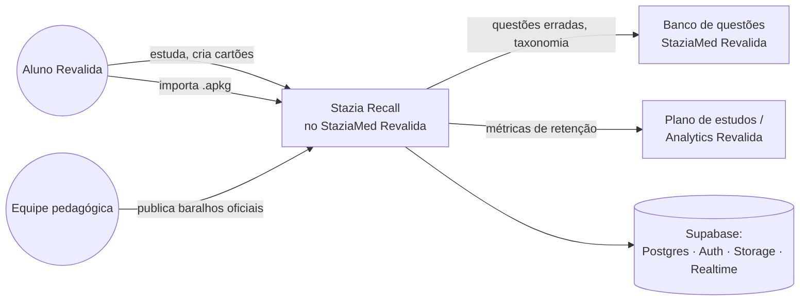

### 13.3 Diagrama de containers (C4 — nível 2)

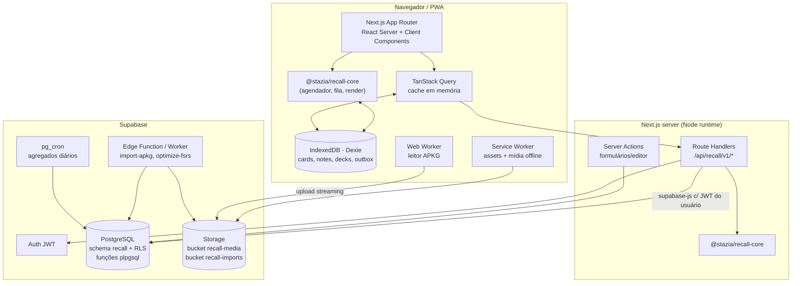

### 13.4 Estrutura de repositório sugerida (monorepo)

```
staziamed-revalida/
├── apps/web/                        # Next.js (já existente no Revalida)
│   └── src/app/
│       ├── (app)/recall/            # páginas do módulo
│       │   ├── page.tsx             # dashboard de baralhos
│       │   ├── study/[deckId]/page.tsx
│       │   ├── browse/page.tsx
│       │   ├── decks/[deckId]/options/page.tsx
│       │   ├── import/page.tsx
│       │   └── stats/page.tsx
│       └── api/recall/v1/...        # Route Handlers (§16)
├── packages/recall-core/            # domínio puro (sem I/O)
│   ├── src/scheduler/               # adaptador ts-fsrs, presets, fuzz/limites
│   ├── src/queue/                   # construtor de fila e limites
│   ├── src/render/                  # templates + cloze + sanitização
│   ├── src/apkg/                    # leitor APKG (fflate, fzstd, sql.js)
│   ├── src/search/                  # parser de busca → AST → filtros SQL
│   └── src/stats/                   # funções de agregação reutilizáveis
├── packages/recall-db/              # tipos gerados (supabase gen types), queries
└── supabase/
    ├── migrations/2026xxxx_recall_*.sql
    ├── functions/import-apkg/       # Edge Function (Deno)
    ├── functions/optimize-fsrs/
    └── tests/recall_*.sql           # pgTAP
```

### 13.5 Decisões arquiteturais (ADRs resumidas)

| # | Decisão | Alternativas consideradas | Motivo |
|---|---|---|---|
| ADR-01 | FSRS-6 via `ts-fsrs` como único algoritmo; SM-2 apenas para importar/converter | Implementar SM-2 + FSRS como o Anki | FSRS é superior; manter dois algoritmos dobra a superfície de testes; usuários do Revalida não têm legado SM-2 |
| ADR-02 | Estado do cartão calculado no servidor (Route Handler) e, offline, no cliente com a mesma lib; servidor reconcilia por *replay* | Calcular no Postgres (plpgsql) | Mesma implementação nos dois lados; ts-fsrs não existe em plpgsql |
| ADR-03 | Revisões com UUID v7 do cliente + `ON CONFLICT DO NOTHING` | Protocolo USN do Anki | Idempotente, simples, compatível com Supabase |
| ADR-04 | Notas com `fields jsonb` (mapa campo→HTML) | Campos unidos por `0x1F` | Validação, busca `jsonb`, evolução de schema |
| ADR-05 | Templates renderizados por motor próprio "Mustache-subset" + sanitização (DOMPurify/`sanitize-html`) | Reaproveitar template do Anki | Licença + segurança (XSS em conteúdo importado) |
| ADR-06 | Filas derivadas por consulta (sem tabela de fila) | Fila materializada | Igual ao Anki; evita inconsistência; índices parciais tornam barato |
| ADR-07 | Mídia em Supabase Storage com chave por SHA-256 (dedupe por usuário) | Pasta por usuário com nomes originais | Dedupe, URLs assinadas, cache imutável |
| ADR-08 | Dia de estudo = timezone do usuário + virada configurável (padrão 04:00) | UTC | Mesma experiência do Anki; evita "dia" quebrado à meia-noite |

---

## 14. Stazia Recall — modelo de dados PostgreSQL

### 14.1 Diagrama ER

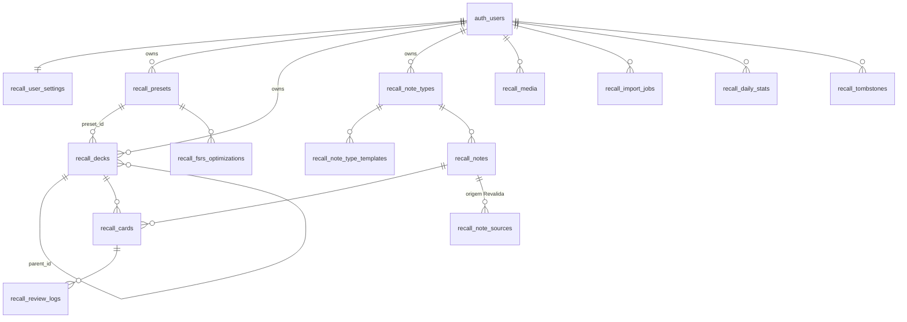

### 14.2 DDL (migração inicial)

> SQL original escrito para este projeto. Ajustar nomes ao padrão do repositório do Revalida.
> Validado sintaticamente: o DDL abaixo e as políticas da §14.3 foram aplicados com sucesso em PostgreSQL embarcado (PGlite) com um schema `auth` simulado (15 tabelas criadas).

```sql
-- supabase/migrations/20261012000000_recall_init.sql
create schema if not exists recall;

-- ===== Enums =====
create type recall.card_state  as enum ('new','learning','review','relearning');
create type recall.card_status as enum ('active','suspended','buried_user','buried_sibling');
create type recall.rating      as enum ('again','hard','good','easy');      -- 1..4
create type recall.review_kind as enum ('learning','review','relearning','cram','manual','reschedule');
create type recall.note_kind   as enum ('basic','cloze','image_occlusion');
create type recall.leech_action as enum ('tag','suspend');
create type recall.import_status as enum ('uploaded','parsing','preview','importing','done','failed','cancelled');

-- ===== Configurações do usuário =====
create table recall.user_settings (
  user_id              uuid primary key references auth.users(id) on delete cascade,
  timezone             text        not null default 'America/Sao_Paulo',
  day_rollover_hour    smallint    not null default 4 check (day_rollover_hour between 0 and 23),
  learn_ahead_minutes  smallint    not null default 20,
  new_ignores_review_limit boolean not null default false,
  show_interval_on_buttons boolean not null default true,
  daily_goal_minutes   smallint,
  created_at           timestamptz not null default now(),
  updated_at           timestamptz not null default now()
);

-- ===== Presets (opções de baralho) =====
create table recall.presets (
  id                   uuid primary key default gen_random_uuid(),
  user_id              uuid not null references auth.users(id) on delete cascade,
  name                 text not null,
  new_per_day          int  not null default 20  check (new_per_day between 0 and 9999),
  reviews_per_day      int  not null default 200 check (reviews_per_day between 0 and 9999),
  learning_steps       text[] not null default '{1m,10m}',
  relearning_steps     text[] not null default '{10m}',
  desired_retention    numeric(4,3) not null default 0.900 check (desired_retention between 0.70 and 0.99),
  maximum_interval     int  not null default 36500,
  fsrs_weights         double precision[],               -- null = padrões; 21 valores (FSRS-6)
  enable_fuzz          boolean not null default true,
  leech_threshold      smallint not null default 8,
  leech_action         recall.leech_action not null default 'tag',
  bury_new_siblings    boolean not null default true,
  bury_review_siblings boolean not null default true,
  new_order            text not null default 'deck_then_position',   -- enum textual validado na app
  review_order         text not null default 'due_then_random',
  new_review_mix       text not null default 'mix',                  -- mix | new_first | reviews_first
  max_answer_seconds   smallint not null default 60,
  version              int not null default 1,
  created_at           timestamptz not null default now(),
  updated_at           timestamptz not null default now(),
  unique (user_id, name),
  check (fsrs_weights is null or array_length(fsrs_weights,1) in (19,21))
);

-- ===== Baralhos =====
create table recall.decks (
  id                   uuid primary key default gen_random_uuid(),
  user_id              uuid not null references auth.users(id) on delete cascade,
  parent_id            uuid references recall.decks(id) on delete cascade,
  name                 text not null,                      -- nome do nível
  path                 text not null,                      -- "Clínica Médica::Cardiologia" (mantido por trigger)
  preset_id            uuid references recall.presets(id) on delete set null,
  description_md       text,
  new_limit_override   int,
  review_limit_override int,
  desired_retention_override numeric(4,3),
  is_official          boolean not null default false,     -- baralho publicado pela StaziaMed
  source_deck_id       uuid,                               -- se assinado de baralho oficial
  collapsed            boolean not null default false,
  deleted_at           timestamptz,
  created_at           timestamptz not null default now(),
  updated_at           timestamptz not null default now(),
  unique (user_id, path)
);
create index on recall.decks (user_id, parent_id);

-- ===== Tipos de nota e templates =====
create table recall.note_types (
  id            uuid primary key default gen_random_uuid(),
  user_id       uuid references auth.users(id) on delete cascade,  -- null = tipo de sistema
  name          text not null,
  kind          recall.note_kind not null default 'basic',
  fields        jsonb not null,           -- [{"key":"front","label":"Frente","rtl":false,"plain":false}]
  sort_field    text not null,
  css           text not null default '',
  origin        jsonb,                    -- {"source":"apkg","external_id":123,"schema_hash":"..."}
  version       int not null default 1,
  created_at    timestamptz not null default now(),
  updated_at    timestamptz not null default now()
);
create table recall.note_type_templates (
  id            uuid primary key default gen_random_uuid(),
  note_type_id  uuid not null references recall.note_types(id) on delete cascade,
  ord           smallint not null,
  name          text not null,
  front_html    text not null,
  back_html     text not null,
  unique (note_type_id, ord)
);

-- ===== Notas =====
create table recall.notes (
  id            uuid primary key default gen_random_uuid(),
  user_id       uuid not null references auth.users(id) on delete cascade,
  note_type_id  uuid not null references recall.note_types(id),
  guid          text not null,                 -- estável; guid do Anki quando importado
  fields        jsonb not null,                -- {"front":"<b>...</b>","back":"..."}
  sort_text     text,                          -- texto puro do sort_field do tipo (trigger)
  first_field_hash bytea,                      -- sha256(texto sem HTML do 1º campo) p/ duplicatas
  tags          text[] not null default '{}',
  search_tsv    tsvector,                      -- mantido por trigger (config 'portuguese' + unaccent)
  version       int not null default 1,
  deleted_at    timestamptz,
  created_at    timestamptz not null default now(),
  updated_at    timestamptz not null default now(),
  unique (user_id, guid)
);
create index on recall.notes using gin (tags);
create index on recall.notes using gin (search_tsv);
create index on recall.notes (user_id, first_field_hash);

-- ===== Cartões (projeção de estado) =====
create table recall.cards (
  id              uuid primary key default gen_random_uuid(),
  user_id         uuid not null references auth.users(id) on delete cascade,
  note_id         uuid not null references recall.notes(id) on delete cascade,
  deck_id         uuid not null references recall.decks(id),
  ord             smallint not null,                    -- template ou nº do cloze - 1
  state           recall.card_state  not null default 'new',
  status          recall.card_status not null default 'active',
  due_at          timestamptz,                          -- null para novos
  new_position    int,                                  -- ordem de introdução
  stability       double precision,
  difficulty      double precision,
  scheduled_days  int not null default 0,
  learning_step   smallint not null default 0,
  reps            int not null default 0,
  lapses          int not null default 0,
  last_review_at  timestamptz,
  flag            smallint not null default 0 check (flag between 0 and 7),
  buried_until    date,                                 -- dia de estudo em que o enterro expira
  is_leech        boolean not null default false,
  version         int not null default 1,               -- concorrência otimista
  deleted_at      timestamptz,
  created_at      timestamptz not null default now(),
  updated_at      timestamptz not null default now(),
  unique (note_id, ord)
);
-- Índices das filas (parciais = baratos)
create index cards_due_idx  on recall.cards (user_id, due_at)
  where status = 'active' and state <> 'new' and deleted_at is null;
create index cards_new_idx  on recall.cards (user_id, deck_id, new_position)
  where status = 'active' and state = 'new' and deleted_at is null;
create index cards_deck_idx on recall.cards (deck_id);

-- ===== Histórico de revisões (append-only, particionado por mês) =====
create table recall.review_logs (
  id              uuid not null,                        -- UUIDv7 gerado no cliente (idempotência)
  user_id         uuid not null references auth.users(id) on delete cascade,
  card_id         uuid not null,
  reviewed_at     timestamptz not null,
  rating          smallint not null check (rating between 0 and 4),   -- 0 = manual
  kind            recall.review_kind not null,
  state_before    recall.card_state not null,
  elapsed_days    double precision not null,
  scheduled_days_before int not null,
  scheduled_days_after  int not null,
  stability_after double precision,
  difficulty_after double precision,
  due_after       timestamptz,
  duration_ms     int not null check (duration_ms >= 0),
  client_id       text,                                  -- dispositivo
  source          text not null default 'study',         -- study | import | manual | reschedule
  created_at      timestamptz not null default now(),
  primary key (user_id, reviewed_at, id)
) partition by range (reviewed_at);
-- Idempotência: a PK (user_id, reviewed_at, id) basta, pois o cliente reenvia o mesmo answeredAt.
create index on recall.review_logs (card_id, reviewed_at);
-- partições mensais criadas por pg_partman ou job; partição default p/ segurança
create table recall.review_logs_default partition of recall.review_logs default;

-- ===== Origem pedagógica (integração Revalida) =====
create table recall.note_sources (
  note_id        uuid primary key references recall.notes(id) on delete cascade,
  user_id        uuid not null references auth.users(id) on delete cascade,
  question_id    uuid,              -- FK lógica p/ public.questions do Revalida
  attempt_id     uuid,              -- tentativa em que o aluno errou
  area           text,              -- Clínica Médica, Cirurgia, Pediatria, GO, Preventiva
  specialty      text,
  topic          text,
  exam_year      smallint,
  created_reason text not null default 'manual'   -- wrong_answer | flagged | manual | official
);
create index on recall.note_sources (user_id, area, specialty);

-- ===== Mídia =====
create table recall.media (
  user_id        uuid not null references auth.users(id) on delete cascade,
  sha256         bytea not null,
  original_name  text not null,
  mime_type      text not null,
  size_bytes     bigint not null check (size_bytes <= 104857600),
  storage_path   text not null,          -- recall-media/{user_id}/{sha256hex}
  created_at     timestamptz not null default now(),
  primary key (user_id, sha256)
);
create unique index on recall.media (user_id, original_name);

-- ===== Importações =====
create table recall.import_jobs (
  id             uuid primary key default gen_random_uuid(),
  user_id        uuid not null references auth.users(id) on delete cascade,
  status         recall.import_status not null default 'uploaded',
  file_path      text not null,
  file_name      text not null,
  package_version smallint,
  options        jsonb not null default '{}',
  preview        jsonb,      -- contagens, decks, notetypes encontrados
  result         jsonb,      -- {new, updated, duplicate, conflicting, media}
  error          text,
  progress       numeric(5,2) not null default 0,
  created_at     timestamptz not null default now(),
  finished_at    timestamptz
);

-- ===== Otimização FSRS =====
create table recall.fsrs_optimizations (
  id             uuid primary key default gen_random_uuid(),
  user_id        uuid not null references auth.users(id) on delete cascade,
  preset_id      uuid not null references recall.presets(id) on delete cascade,
  review_count   int not null,
  weights_before double precision[],
  weights_after  double precision[],
  logloss_before double precision,
  logloss_after  double precision,
  rmse_bins_after double precision,
  applied        boolean not null default false,
  created_at     timestamptz not null default now()
);

-- ===== Agregados diários (estatísticas rápidas) =====
create table recall.daily_stats (
  user_id        uuid not null references auth.users(id) on delete cascade,
  study_day      date not null,
  deck_id        uuid not null,   -- totais do usuário = soma por baralho
  new_count      int not null default 0,
  learn_count    int not null default 0,
  review_count   int not null default 0,
  relearn_count  int not null default 0,
  again_count    int not null default 0,
  young_pass     int not null default 0,
  young_fail     int not null default 0,
  mature_pass    int not null default 0,
  mature_fail    int not null default 0,
  total_ms       bigint not null default 0,
  primary key (user_id, study_day, deck_id)
);

-- ===== Lápides para sync incremental do cache offline =====
create table recall.tombstones (
  user_id     uuid not null,
  entity      text not null check (entity in ('card','note','deck','note_type','preset')),
  entity_id   uuid not null,
  deleted_at  timestamptz not null default now(),
  primary key (user_id, entity, entity_id)
);
create index on recall.tombstones (user_id, deleted_at);
```

### 14.3 RLS (exemplo aplicado a todas as tabelas com `user_id`)

```sql
alter table recall.cards enable row level security;

create policy cards_owner_select on recall.cards
  for select using (user_id = (select auth.uid()));
create policy cards_owner_write on recall.cards
  for all using (user_id = (select auth.uid()))
  with check (user_id = (select auth.uid()));

-- Tipos de nota de sistema (user_id null) são legíveis por todos os autenticados
create policy note_types_read on recall.note_types
  for select using (user_id is null or user_id = (select auth.uid()));

-- review_logs: INSERT e SELECT apenas (append-only); UPDATE/DELETE proibidos
alter table recall.review_logs enable row level security;
create policy rl_insert on recall.review_logs for insert with check (user_id = (select auth.uid()));
create policy rl_select on recall.review_logs for select using (user_id = (select auth.uid()));
```

Baralhos oficiais (StaziaMed): publicados em tabelas `recall.official_*` (somente leitura para alunos) e **copiados** para o espaço do aluno quando ele assina o baralho (`source_deck_id`), preservando `guid` para atualizações futuras via mesmo mecanismo de import (atualizar se mais novo).

### 14.4 Funções de banco essenciais

| Função | Tipo | Descrição |
|---|---|---|
| `recall.study_day(user_id, ts)` | `stable sql` | Converte timestamp para "dia de estudo" (timezone + virada) |
| `recall.study_day_bounds(user_id, day)` | `stable sql` | Início/fim do dia de estudo em `timestamptz` |
| `recall.deck_counts(user_id, now)` | `stable plpgsql` | Árvore de baralhos com contagens novo/aprendizado/revisão respeitando limites hierárquicos |
| `recall.fetch_queue(user_id, deck_id, now, limit)` | `stable plpgsql` | Retorna candidatos da fila (§15.4) |
| `recall.apply_review(payload jsonb)` | `security invoker plpgsql` | Insere log + atualiza card com verificação de `version`, enterra irmãos, atualiza `daily_stats` — em uma transação |
| `recall.unbury_expired(user_id)` | `plpgsql` | Reativa cartões cujo `buried_until` passou |
| Triggers | | `updated_at`, `version++`, `decks.path`, `notes.search_tsv`, `tombstones` em soft-delete |

---

## 15. Stazia Recall — motor de agendamento

### 15.1 Adaptador sobre `ts-fsrs`

O núcleo expõe uma interface estável; `ts-fsrs` fica encapsulado (troca futura sem impacto).

```ts
// packages/recall-core/src/scheduler/types.ts
export type Rating = 1 | 2 | 3 | 4;                       // again | hard | good | easy
export type CardState = 'new' | 'learning' | 'review' | 'relearning';

export interface SchedCard {
  id: string;
  state: CardState;
  dueAt: Date | null;
  stability: number | null;
  difficulty: number | null;
  scheduledDays: number;
  learningStep: number;
  reps: number;
  lapses: number;
  lastReviewAt: Date | null;
}

export interface PresetParams {
  desiredRetention: number;        // 0.70..0.99
  maximumInterval: number;         // dias
  weights: readonly number[] | null;
  learningSteps: string[];         // ["1m","10m"]
  relearningSteps: string[];       // ["10m"]
  enableFuzz: boolean;
  leechThreshold: number;
}

export interface Preview {                     // equivalente a "SchedulingStates"
  rating: Rating;
  next: SchedCard;
  intervalLabel: string;                       // "10 min", "3 d", "2,1 m"
  log: ReviewLogDraft;
}

export interface Scheduler {
  preview(card: SchedCard, now: Date): Record<Rating, Preview>;
  answer(card: SchedCard, rating: Rating, now: Date): Preview;
  retrievability(card: SchedCard, now: Date): number | null;
  forget(card: SchedCard, now: Date): SchedCard;
  replay(initial: SchedCard, logs: ReviewEvent[]): SchedCard; // reconstrói por replay
}
```

Implementação (resumo):

```ts
// packages/recall-core/src/scheduler/fsrs-adapter.ts
import { fsrs, generatorParameters, createEmptyCard, Rating as R, State } from 'ts-fsrs';

export function createScheduler(p: PresetParams, seedFor: (c: SchedCard) => string): Scheduler {
  const engine = fsrs(generatorParameters({
    request_retention: p.desiredRetention,
    maximum_interval: p.maximumInterval,
    w: p.weights ?? undefined,                 // undefined → padrões FSRS-6 da lib
    enable_fuzz: p.enableFuzz,
    enable_short_term: true,
    learning_steps: p.learningSteps as any,
    relearning_steps: p.relearningSteps as any,
  }));
  // Fuzz determinístico por (cardId, reps) — mesma previsão no cliente e no servidor
  // via estratégia de seed da lib (StrategyMode.SEED).
  // ...mapear SchedCard <-> Card do ts-fsrs, chamar engine.repeat()/engine.next()
}
```

> Verificar a API exata contra a versão fixada no `package.json` (`ts-fsrs@5.4.2`: `fsrs()`, `generatorParameters()`, `createEmptyCard()`, `repeat()`, `next()`, `get_retrievability()`, `forget()`, `reschedule()`, `rollback()`, `StrategyMode.SEED`).

### 15.2 Regras próprias do Stazia Recall (em cima do FSRS)

| Regra | Comportamento |
|---|---|
| Dia de estudo | Revisões com intervalo ≥ 1 dia têm `due_at` = início do dia de estudo alvo (timezone + virada 04:00) |
| Cap de tempo | `duration_ms` limitado a `max_answer_seconds × 1000` antes de gravar |
| Leech | `lapses ≥ threshold` e `(lapses − threshold) % ceil(threshold/2) == 0` → `is_leech = true`, tag `leech`; se preset = `suspend`, `status='suspended'` |
| Irmãos | Ao responder, irmãos da mesma nota que estão novos/em revisão hoje recebem `status='buried_sibling'`, `buried_until = amanhã` (conforme preset) |
| Retenção por baralho | `deck.desired_retention_override` > `preset.desired_retention` |
| Concorrência | `apply_review` exige `expected_version`; em conflito, servidor faz *replay* (§17.3) |
| Pré-visualização | Botões mostram `intervalLabel` de `preview()`; nunca calculado de outra forma |

### 15.3 Otimização de parâmetros (job assíncrono)

1. Disparo: manual ("Otimizar meus parâmetros") ou automático a cada 1.000 novas revisões / 30 dias.
2. Edge Function/worker Node carrega `review_logs` do preset (somente `rating 1..4`, ignora `cram` e corta em `manual` reset), agrupa por cartão, gera sequências `(rating, delta_t)`.
3. Chama o otimizador (`@open-spaced-repetition/binding`, MIT). Regras: < 8 itens → mantém padrão; aceita novos pesos **apenas se a log-loss melhorar** (mesma política do Anki, reimplementada).
4. Registra em `recall.fsrs_optimizations`; aplica no preset; opcionalmente reagenda cartões (`reschedule`), gravando logs `kind='reschedule'`.

### 15.4 Construção da fila (algoritmo próprio)

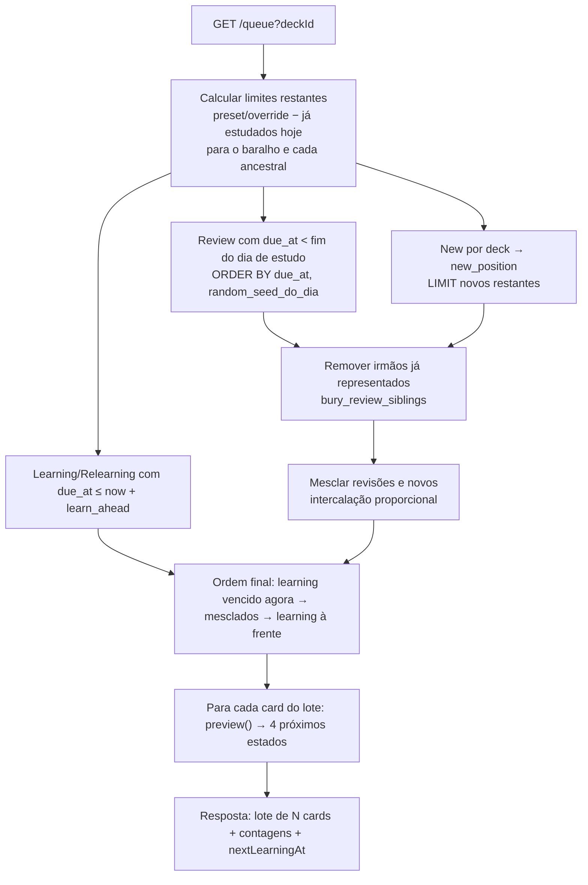

- **Lote**: o servidor retorna 20 cartões com previsões já calculadas e os HTMLs renderizados; o cliente reconsulta quando restam 5 ou após um "Again" que reinsere um cartão em aprendizado.
- **Limites hierárquicos** (reimplementação da ideia): `restante(baralho) = min(limite_próprio − feito_hoje, restante(pai))`; cada cartão retirado decrementa o baralho e todos os ancestrais.
- **Aleatoriedade estável no dia**: `hashtext(card_id::text || study_day::text)` para desempates.

SQL ilustrativo das revisões vencidas:

```sql
select c.*
from recall.cards c
join recall.decks d on d.id = c.deck_id
where c.user_id = $1
  and d.path like $2 || '%'               -- baralho e subbaralhos
  and c.status = 'active' and c.deleted_at is null
  and c.state = 'review'
  and c.due_at < $3                        -- fim do dia de estudo
order by c.due_at, hashtext(c.id::text || $4::text)
limit $5;
```

---

## 16. Stazia Recall — contratos de API

### 16.1 Convenções

- Base: `/api/recall/v1`. JSON, `camelCase`. Autenticação: cookie de sessão Supabase (`@supabase/ssr`) ou `Authorization: Bearer <jwt>`.
- Validação com **zod** (schemas compartilhados em `@stazia/recall-core/contracts`), tipos inferidos no cliente.
- Erros: `application/problem+json` → `{ type, title, status, detail, code, errors? }`. Códigos: `VALIDATION_ERROR` (422), `NOT_FOUND` (404), `VERSION_CONFLICT` (409), `RATE_LIMITED` (429), `IMPORT_INVALID_PACKAGE` (422), `UNAUTHENTICATED` (401).
- Idempotência: mutações aceitam `Idempotency-Key` (UUID); revisões usam o próprio `reviewId`.
- Paginação: cursor opaco (`?cursor=&limit=`).
- Toda mutação retorna `changes: { decks?: boolean, queue?: boolean, cards?: string[], notes?: string[], stats?: boolean }` para invalidação de cache (inspirado em `OpChanges`).

### 16.2 Catálogo de endpoints

| Método | Rota | Descrição |
|---|---|---|
| GET | `/decks` | Árvore de baralhos com contagens (novo/aprendizado/revisão) do dia |
| POST | `/decks` | Criar baralho `{ name, parentId?, presetId? }` |
| PATCH | `/decks/{id}` | Renomear, mover, trocar preset, overrides |
| DELETE | `/decks/{id}` | Soft delete (cartões juntos) |
| GET/POST/PATCH | `/presets`, `/presets/{id}` | CRUD de presets |
| POST | `/presets/{id}/optimize` | Dispara otimização FSRS → `202 { jobId }` |
| GET | `/presets/{id}/simulate?retention=0.85` | Simulação de carga diária |
| GET/POST | `/note-types` | Listar/criar tipos de nota |
| POST | `/notes` | Criar nota (gera cartões) |
| GET | `/notes/{id}` · PATCH · DELETE | Ler/editar/remover |
| POST | `/notes/from-question` | **Revalida**: cria nota a partir de questão (§19.3) |
| GET | `/cards/search?q=&cursor=` | Navegador de cartões (busca) |
| POST | `/cards/bulk` | Ações em lote: `suspend`, `unsuspend`, `bury`, `unbury`, `move`, `flag`, `forget`, `setDue`, `tag` |
| GET | `/study/queue?deckId=&limit=20` | Lote da fila com previsões e HTML |
| POST | `/study/answer` | Responder um cartão |
| POST | `/study/undo` | Desfazer última resposta |
| POST | `/sync/push` | Enviar outbox offline (lote de eventos) |
| GET | `/sync/pull?since=` | Delta de entidades e lápides desde cursor |
| POST | `/imports` | Criar job de import (após upload ao Storage) |
| GET | `/imports/{id}` | Status/preview/resultado |
| POST | `/imports/{id}/confirm` | Confirmar com opções |
| POST | `/exports` | Exportar baralho (`.apkg`-compatível ou CSV) |
| GET | `/stats/overview?deckId=&range=` | Hoje, retenção real, carga futura, contagens |
| GET | `/stats/graphs?deckId=&range=&graphs=` | Séries para gráficos |
| GET | `/cards/{id}/info` | Histórico, S/D/R, curva de esquecimento |
| GET | `/media/{sha256}` | Redireciona para URL assinada |

### 16.3 Contratos detalhados (zod)

```ts
// packages/recall-core/src/contracts/study.ts
import { z } from 'zod';

export const RatingSchema = z.union([z.literal(1), z.literal(2), z.literal(3), z.literal(4)]);

export const QueueRequest = z.object({
  deckId: z.string().uuid().optional(),     // ausente = todos
  limit: z.number().int().min(1).max(50).default(20),
});

export const NextStatePreview = z.object({
  rating: RatingSchema,
  intervalLabel: z.string(),               // "<10 min", "1 d", "3,2 m"
  dueAt: z.string().datetime(),
});

export const QueueCard = z.object({
  cardId: z.string().uuid(),
  version: z.number().int(),
  queue: z.enum(['new', 'learning', 'review']),
  deckPath: z.string(),
  frontHtml: z.string(),                    // já sanitizado
  backHtml: z.string(),
  css: z.string(),
  media: z.array(z.object({ name: z.string(), url: z.string().url() })),
  previews: z.array(NextStatePreview).length(4),
  retrievability: z.number().min(0).max(1).nullable(),
  source: z.object({ questionId: z.string().uuid().nullable(), specialty: z.string().nullable() }).nullable(),
});

export const QueueResponse = z.object({
  cards: z.array(QueueCard),
  counts: z.object({ new: z.number(), learning: z.number(), review: z.number() }),
  nextLearningAt: z.string().datetime().nullable(),   // p/ tela "Parabéns"
  studyDay: z.string(),                               // "2026-10-12"
});

export const AnswerRequest = z.object({
  reviewId: z.string().uuid(),             // UUIDv7 gerado no cliente
  cardId: z.string().uuid(),
  expectedVersion: z.number().int(),
  rating: RatingSchema,
  answeredAt: z.string().datetime(),       // relógio do cliente (validado: |skew| ≤ 5 min online)
  durationMs: z.number().int().min(0).max(3_600_000),
  clientId: z.string().max(64),
});

export const AnswerResponse = z.object({
  card: z.object({
    cardId: z.string().uuid(), version: z.number().int(),
    state: z.enum(['new','learning','review','relearning']),
    dueAt: z.string().datetime().nullable(),
    stability: z.number().nullable(), difficulty: z.number().nullable(),
    isLeech: z.boolean(), suspended: z.boolean(),
  }),
  buriedSiblings: z.array(z.string().uuid()),
  duplicate: z.boolean(),                  // true se reviewId já existia (idempotente)
  changes: z.object({ queue: z.literal(true), stats: z.literal(true) }),
});
```

Exemplo:

```http
POST /api/recall/v1/study/answer
Content-Type: application/json

{ "reviewId":"01928f3e-7b1c-7e2a-9f00-3c4d5e6f7a8b", "cardId":"7c0e…", "expectedVersion":5,
  "rating":3, "answeredAt":"2026-10-12T13:05:22.120Z", "durationMs":8420, "clientId":"web-3f9a" }

200 OK
{ "card": { "cardId":"7c0e…", "version":6, "state":"review", "dueAt":"2026-10-19T07:00:00.000Z",
            "stability":7.41, "difficulty":5.12, "isLeech":false, "suspended":false },
  "buriedSiblings": [], "duplicate": false, "changes": { "queue": true, "stats": true } }
```

```ts
// packages/recall-core/src/contracts/sync.ts
export const SyncEvent = z.discriminatedUnion('type', [
  z.object({ type: z.literal('review'), payload: AnswerRequest }),
  z.object({ type: z.literal('card.bulk'), id: z.string().uuid(), payload: z.object({
    action: z.enum(['suspend','unsuspend','bury','unbury','flag','move','tag']),
    cardIds: z.array(z.string().uuid()).max(500), value: z.unknown().optional() }) }),
  z.object({ type: z.literal('note.upsert'), id: z.string().uuid(), payload: z.object({
    noteId: z.string().uuid(), expectedVersion: z.number().int().nullable(),
    noteTypeId: z.string().uuid(), deckId: z.string().uuid(),
    fields: z.record(z.string(), z.string()), tags: z.array(z.string()) }) }),
]);
export const SyncPushRequest  = z.object({ clientId: z.string(), events: z.array(SyncEvent).max(500) });
export const SyncPushResponse = z.object({
  results: z.array(z.object({ id: z.string(), status: z.enum(['applied','duplicate','replayed','rejected']),
                              error: z.string().optional() })),
  cursor: z.string(),
});
export const SyncPullResponse = z.object({
  cursor: z.string(),
  decks: z.array(z.unknown()), presets: z.array(z.unknown()), noteTypes: z.array(z.unknown()),
  notes: z.array(z.unknown()), cards: z.array(z.unknown()),
  tombstones: z.array(z.object({ entity: z.string(), id: z.string().uuid() })),
  hasMore: z.boolean(),
});
```

```ts
// packages/recall-core/src/contracts/import.ts
export const ImportOptions = z.object({
  targetDeckId: z.string().uuid().nullable(),     // null = manter hierarquia do pacote
  includeScheduling: z.boolean().default(false),  // importar revlog e converter p/ FSRS
  updateExisting: z.enum(['if_newer','always','never']).default('if_newer'),
  tagWith: z.array(z.string()).default([]),
});
export const ImportPreview = z.object({
  packageVersion: z.union([z.literal(1), z.literal(2), z.literal(3)]),
  notes: z.number(), cards: z.number(), reviews: z.number(), media: z.number(),
  decks: z.array(z.object({ path: z.string(), cards: z.number() })),
  noteTypes: z.array(z.object({ name: z.string(), kind: z.string(), fields: z.array(z.string()) })),
  duplicatesByGuid: z.number(),
  warnings: z.array(z.string()),                 // ex.: "scripts removidos de 3 templates"
});
```

### 16.4 Limites e segurança da API

- Rate limit: `/study/answer` 5 req/s por usuário; `/imports` 5/h; `/presets/*/optimize` 3/dia.
- Upload de `.apkg` direto ao Storage com URL assinada (máx. 500 MB), nunca pelo Route Handler.
- Todo HTML de cartão é sanitizado **no servidor** ao renderizar (sem `<script>`, `on*`, `javascript:`), e exibido em `<iframe sandbox>` com CSP estrita — conteúdo importado é não confiável (mesma preocupação que levou o Anki a restringir o revisor a 4 endpoints).

---

## 17. Stazia Recall — offline e sincronização

### 17.1 Modelo

O Anki replica um banco SQLite inteiro entre pares (USN, graves, chunks, full sync). Para um SaaS isso é desnecessário: o servidor é autoritativo e o cliente precisa apenas de **(a)** um cache local consultável e **(b)** uma fila de intenções. Comparação:

| Aspecto | Anki | Stazia Recall |
|---|---|---|
| Fonte de verdade | Cada cópia; servidor reconcilia | PostgreSQL |
| Mudança pendente | `usn = -1` na linha | Evento no `outbox` (IndexedDB) |
| Revisões | `INSERT OR IGNORE` no revlog | `INSERT … ON CONFLICT DO NOTHING` por `reviewId` |
| Exclusões | Tabela `graves` | Tabela `tombstones` + `deleted_at` |
| Conflito de card | mtime mais novo vence | **Replay** cronológico das revisões |
| Conflito de nota | mtime mais novo vence | `expectedVersion`; conflito → última escrita vence + cópia da versão perdida no histórico de edição |
| Mudança de schema | Força *full sync* | Migração no servidor; cliente invalida cache por `schemaVersion` |
| Mídia | Protocolo próprio, SHA-1, ZIP | Storage + Service Worker (cache-first por SHA-256 imutável) |

### 17.2 Fluxo offline

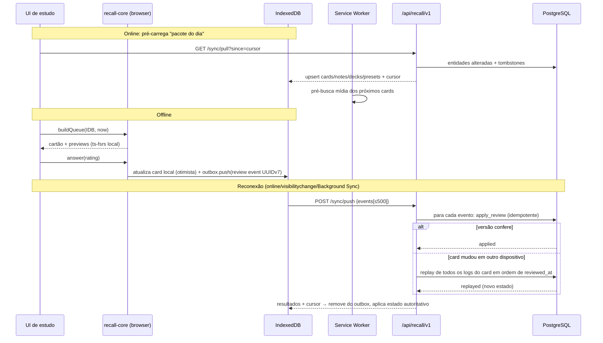

### 17.3 Reconciliação por replay

Como `review_logs` é imutável e cada log guarda `reviewed_at` e `rating`, o estado de um cartão é `fold(scheduler.answer, estado_inicial, logs ordenados)`. Se dois dispositivos responderam o mesmo cartão offline:

1. Ambos os eventos são inseridos (IDs distintos).
2. O servidor detecta `expectedVersion` divergente e chama `scheduler.replay(cardInicial, todosOsLogs)`.
3. O card é regravado com o estado resultante; os campos `*_after` dos logs são recalculados.
4. O cliente recebe `status:'replayed'` e o estado autoritativo.

Regras adicionais: eventos com `answeredAt` no futuro (> now + 5 min) são rejeitados; eventos com mais de 30 dias de atraso são aceitos mas marcados (`source='late_sync'`) para auditoria; operações manuais (`forget`, `setDue`) entram no replay como logs `rating=0, kind='manual'` — exatamente como o Anki trata reset/set-due no revlog.

### 17.4 Armazenamento local (Dexie)

```ts
db.version(1).stores({
  cards:     'id, deckId, [state+dueAt], noteId, updatedAt',
  notes:     'id, noteTypeId, updatedAt',
  decks:     'id, parentId, path',
  presets:   'id',
  noteTypes: 'id',
  outbox:    '++seq, id, type, createdAt',
  meta:      'key',          // cursor, schemaVersion, userId, lastPullAt
});
```

Escopo offline padrão: baralhos marcados "disponível offline" + cartões com vencimento nos próximos 7 dias + todos os novos do limite diário. Limpeza ao trocar de usuário (chave `meta.userId`).

---

## 18. Stazia Recall — importação APKG

### 18.1 Pipeline

```mermaid
flowchart LR
    U[Usuário escolhe .apkg] --> UP[Upload direto ao Storage<br/>URL assinada · bucket recall-imports]
    UP --> J[POST /imports → job 'uploaded']
    J --> W[Worker import-apkg]
    W --> Z[Descompactar ZIP<br/>fflate streaming]
    Z --> V{Detectar versão}
    V -->|meta protobuf v3| Z3[collection.anki21b<br/>fzstd → bytes SQLite]
    V -->|anki21| Z2[SQLite legado]
    V -->|anki2| Z1[SQLite legado]
    Z3 & Z2 & Z1 --> SQ[Abrir com sql.js<br/>em memória]
    SQ --> RD[Ler notetypes, decks, notes,<br/>cards, revlog · schema 11 ou 18]
    RD --> PV[Preview → job 'preview']
    PV --> C[Usuário confirma opções]
    C --> MAP[Mapear para modelo Stazia]
    MAP --> MED[Mídia: SHA-256, dedupe,<br/>upload, reescrita de refs]
    MAP --> SAN[Sanitizar templates/campos]
    MAP --> INS[Inserir em lotes de 1.000<br/>transação por lote · guid dedupe]
    INS --> FS[Se includeScheduling:<br/>converter revlog → review_logs<br/>e recalcular FSRS por replay]
    FS --> D[job 'done' + resultado]
```

### 18.2 Regras de leitura do formato (interoperabilidade)

- **Detecção**: presença da entrada `meta` (protobuf, campo 1 = versão); senão `collection.anki21` → legado 2; senão `collection.anki2` → legado 1. Versão desconhecida/0 → erro "pacote mais novo que o suportado".
- **Schema 18**: notetypes/campos/templates/decks/presets em tabelas com blobs protobuf — o leitor precisa de definições `.proto` **próprias e mínimas** apenas com os campos lidos (nome, ordem, `qfmt`, `afmt`, CSS, kind) — escritas a partir da observação do formato, não copiadas.
- **Schema 11**: tudo em JSON dentro de `col.models`, `col.decks`, `col.dconf`.
- **Notas**: `flds` separado por `\x1f` → `fields` jsonb na ordem dos campos do notetype; `tags` por espaço; `guid` preservado (atualizações futuras do mesmo baralho casam por guid).
- **Mídia**: mapa `media` (JSON `{"0":"img.png"}` ou protobuf zstd `MediaEntries`); arquivos numerados (zstd na v3). Referências nos campos: ``, `<audio>`, `<source>`, `[sound:arquivo.mp3]` (convertido para `<audio controls>`).
- **Agendamento** (opcional): `cards.type/queue/due/ivl/factor/reps/lapses` + `revlog`. Recomenda-se **não** copiar o estado SM-2; em vez disso importar o revlog como `review_logs` (`ease`→`rating`, `type`→`kind`, `id` ms→`reviewed_at`, `time`→`duration_ms`) e calcular o estado FSRS por *replay*. Se não houver revlog, usar a conversão SM-2→FSRS (S a partir do intervalo, D a partir do ease — fórmulas da §5.5) via `ts-fsrs`.
- **Templates**: converter sintaxe `{{Campo}}`, `{{#Campo}}`, `{{^Campo}}`, `{{cloze:Campo}}`, `{{type:Campo}}` (→ campo de digitação), `{{hint:Campo}}`, `{{FrontSide}}`, `{{text:Campo}}`, `{{Tags}}`, `{{Deck}}`; filtros desconhecidos → texto do campo + aviso. Remover `<script>` (comum em baralhos com add-ons) e registrar aviso.
- **Limites**: 500 MB por pacote; 200 mil notas; 10 mil arquivos de mídia; tempo máximo de job 15 min (dividir em fases retomáveis).

### 18.3 Exportação

- **CSV/TSV** com cabeçalhos (separador, html, colunas de deck/tags/guid) — formato aberto.
- **`.apkg`-compatível** (fase 3, opcional): gerar `collection.anki2` (schema 11, mais simples e lido por todas as versões) com `sql.js`, mapa de mídia JSON e arquivos numerados. Escrito do zero a partir do formato descrito na §9.

---

## 19. Stazia Recall — interface e integração com o Revalida

### 19.1 Telas

| Tela | Rota | Conteúdo |
|---|---|---|
| Painel | `/recall` | Árvore de baralhos (Novos · Aprendendo · Revisar), meta diária, sequência, "Estudar tudo", baralhos oficiais sugeridos por desempenho no Revalida |
| Estudo | `/recall/study/[deckId]` | Frente → "Mostrar resposta" → verso + 4 botões com intervalos; barra de progresso; contadores; timer opcional; ações (editar, marcar, bandeira, enterrar, suspender, desfazer, ver questão de origem) |
| Parabéns | (estado da tela de estudo) | Resumo da sessão, próximo aprendizado em X min, sugestões (custom study, questões do tema) |
| Navegador | `/recall/browse` | Busca (sintaxe própria simplificada: `deck:`, `tag:`, `is:due`, `is:new`, `is:suspended`, `area:`, `specialty:`, `prop:r<0.8`), tabela virtualizada, ações em lote |
| Editor | modal/página | Rich text (TipTap), cloze (Ctrl+Shift+C), imagem, LaTeX (KaTeX), tags, pré-visualização |
| Opções | `/recall/decks/[id]/options` | Preset, limites, passos, retenção desejada com simulador, otimizar FSRS, ordem |
| Importar | `/recall/import` | Upload, preview, opções, progresso |
| Estatísticas | `/recall/stats` | §20 |

### 19.2 Requisitos de UX do estudo

- Atalhos: `Espaço/Enter` (mostrar/Good), `1–4`, `Z` desfazer, `E` editar, `S` suspender, `B` enterrar, `F` bandeira, `Q` abrir questão de origem.
- Mobile: botões grandes na zona do polegar; gestos (swipe) opcionais.
- Latência: resposta otimista (< 50 ms percebidos); próximo cartão já pré-renderizado; mídia pré-carregada.
- Acessibilidade: WCAG 2.2 AA, foco visível, `aria-live` para troca de cartão, contraste em modo escuro.
- Renderização isolada em `<iframe sandbox="allow-same-origin">` com CSS do tipo de nota + tema; KaTeX para fórmulas; áudio com `<audio>` nativo.

### 19.3 Integração com o banco de questões do Revalida

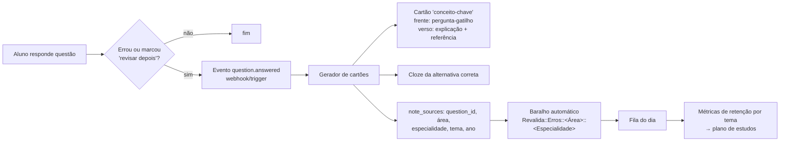

- **Criação**: endpoint `POST /notes/from-question { questionId, attemptId, template: 'concept'|'cloze'|'both' }`. Conteúdo inicial gerado a partir do comentário oficial da questão (texto da equipe StaziaMed); o aluno pode editar antes de salvar. Opção de geração assistida por IA deve ser revisável e marcada como tal.
- **Deduplicação**: uma nota por `(user_id, question_id, template)` — errar de novo a mesma questão **não** cria duplicata; em vez disso registra um log `manual` "relapso externo" que pode reduzir o intervalo (configurável).
- **Taxonomia**: tags hierárquicas `revalida::clinica-medica::cardiologia::insuficiencia-cardiaca` + colunas em `note_sources` para agregação eficiente.
- **Retroalimentação**: retenção real e retrievability média por especialidade alimentam o "radar de fraquezas" do Revalida e o plano semanal (ex.: priorizar simulados de temas com R média < 0,75).
- **Baralhos oficiais**: equipe pedagógica publica baralhos versionados (ex.: "Revalida — Alto rendimento 2027"); aluno assina; atualizações chegam via mesmo pipeline de import (casamento por `guid`, regra `if_newer`), preservando o agendamento do aluno.

---

## 20. Stazia Recall — estatísticas

| Métrica | Fonte | Implementação |
|---|---|---|
| Hoje (cartões, tempo, % acerto) | `daily_stats` | leitura direta |
| **Retenção real** (jovem < 21 d / maduro ≥ 21 d) por período | `daily_stats.young_* / mature_*` | soma por janela; `pass/(pass+fail)` |
| Carga futura (30/90 dias) | `cards.due_at` | `group by study_day(due_at)` |
| Calendário (heatmap) | `daily_stats` | 365 dias |
| Revisões por tipo | `daily_stats` | barras empilhadas |
| Contagem de cartões | `cards` | novo/aprendendo/jovem/maduro/suspenso |
| Estabilidade, Dificuldade | `cards` | histogramas + mediana |
| **Retrievability** e "conhecimento estimado" | `cards` + `ts-fsrs` | `R(t,S)` no servidor; `Σ R` |
| Distribuição por hora | `review_logs` | materialized view mensal |
| Botões | `review_logs` | % por botão e fase |
| **Por especialidade Revalida** | `cards` ⨝ `note_sources` | R média, retenção real, carga, leeches por área/especialidade |
| Info do cartão | `review_logs` do card | histórico + curva `R(t)` |

Implementação: `recall.daily_stats` atualizada dentro de `apply_review` (incremento atômico); views materializadas para séries pesadas atualizadas por `pg_cron` de madrugada (no fuso do usuário agrupado). Gráficos com Recharts ou visx no cliente; os dados vêm prontos da API (o cliente não agrega logs brutos).

---

## 21. Plano de implementação

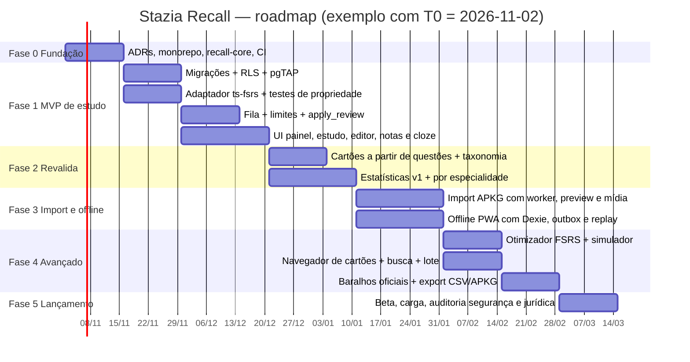

| Fase | Entregáveis | Critérios de aceite |
|---|---|---|
| **0 — Fundação** (2 sem) | ADRs; pacote `recall-core`; pipeline CI (lint, typecheck, vitest, pgTAP, Playwright); feature flag `recall` | CI verde; `THIRD_PARTY_NOTICES.md` |
| **1 — MVP de estudo** (5 sem) | Schema + RLS; CRUD baralhos/presets/notas (básico + cloze); fila; responder; desfazer; painel; tela de estudo | Estudar 1.000 cartões sem erro; p95 `/study/answer` < 150 ms; testes de RLS cobrindo todas as tabelas |
| **2 — Integração Revalida** (3 sem) | `from-question`, baralhos automáticos por área, estatísticas v1, radar por especialidade | Erro em questão gera cartão em < 2 s; dedupe por questão |
| **3 — Import + Offline** (3 sem) | Import APKG v1/v2/v3 com mídia e revlog; PWA offline com outbox e replay | Corpus de 20 `.apkg` reais importa sem perda; 200 respostas offline sincronizam sem divergência |
| **4 — Avançado** (4 sem) | Otimizador FSRS, simulador de retenção, navegador com busca, ações em lote, baralhos oficiais, export | Log-loss pós-otimização ≤ pré; busca < 300 ms em 50 mil cartões |
| **5 — Lançamento** (2 sem) | Beta, testes de carga (k6), pentest, revisão jurídica de licenças/termos | 0 vulnerabilidades altas; aprovação jurídica |

**Equipe sugerida:** 2 full-stack (Next.js/TS), 1 backend/DB (Postgres/Supabase), 0,5 designer, 0,5 QA, 0,25 pedagógico (taxonomia/baralhos oficiais).

---

## 22. Estratégia de testes

### 22.1 Pirâmide

| Camada | Ferramenta | Escopo |
|---|---|---|
| Unidade (núcleo) | **Vitest** | Agendador, fila, limites, fuzz determinístico, render de templates, cloze, parser de busca, leitor APKG |
| Propriedades | **fast-check** | Invariantes do agendador e do replay |
| Banco | **pgTAP** + `supabase test db` | RLS, funções `apply_review`, `deck_counts`, triggers, partições |
| Integração API | Vitest + Supabase local (`supabase start`) | Contratos zod, idempotência, conflitos 409, replay |
| E2E | **Playwright** (Chromium) | Fluxo de estudo, atalhos, offline (`context.setOffline(true)`), import |
| Carga | **k6** | 500 usuários simultâneos respondendo 1 cartão/5 s |
| Segurança | ZAP + revisão manual | XSS em cartões importados, IDOR, RLS |

### 22.2 Casos de teste essenciais

**Agendador (`scheduler.spec.ts`)**
1. Cartão novo + Good com passos `[1m,10m]` → `learning`, due ≈ +10 min (Again → +1 min; Easy → `review`, ≥ 1 dia).
2. Graduação: Good no último passo → `review` com `scheduledDays ≥ 1`.
3. Monotonicidade: para o mesmo cartão em `review`, `interval(Again) ≤ interval(Hard) ≤ interval(Good) ≤ interval(Easy)`.
4. Retenção: aumentar `desiredRetention` nunca aumenta o intervalo de Good.
5. `R(S, S) = 0,9 ± 1e-6` para qualquer S (propriedade da curva).
6. Limites: `scheduledDays ≤ maximumInterval`; D ∈ [1,10]; S > 0.
7. Fuzz determinístico: `preview()` chamado 2× (cliente e servidor) com mesmo card/agora → mesmos `dueAt`.
8. Leech: com limiar 8, `isLeech` em lapsos 8, 12, 16 e não em 9–11.
9. Paridade com referência: vetores de teste públicos do `ts-fsrs` (S/D após sequências de notas) com tolerância 1e-4.

**Replay (`replay.property.spec.ts`)**
10. `replay(inicial, logs)` == aplicação sequencial de `answer()` (propriedade com sequências aleatórias de 1–50 notas e intervalos aleatórios).
11. Ordem de chegada irrelevante: embaralhar a ordem de inserção de logs e aplicar replay produz o mesmo estado final.
12. Idempotência: reaplicar o mesmo `reviewId` não altera o estado.

**Fila (`queue.spec.ts`)**
13. Limite de novos 20 com 50 disponíveis → 20; após responder 5 → 15.
14. Limite hierárquico: pai com limite 10 e dois filhos com 20 cada → total ≤ 10.
15. Ordem: learning vencido antes de revisões; learning "à frente" só se fila vazia e dentro de `learnAhead`.
16. Virada do dia às 04:00 em `America/Sao_Paulo`: revisão às 03:59 conta para o dia anterior.
17. Irmãos: com `buryNewSiblings`, dois cartões da mesma nota não aparecem no mesmo dia.

**Banco (pgTAP)**
18. Usuário A não lê/escreve cartões, notas, logs, mídia de B (todas as tabelas).
19. `review_logs` rejeita UPDATE/DELETE.
20. `apply_review` com `expected_version` errado → erro `VERSION_CONFLICT`.
21. `apply_review` incrementa `daily_stats` corretamente (young/mature por `scheduled_days_before ≥ 21`).

**Import (`apkg.spec.ts`)** — com fixtures **criadas pela equipe** (não baralhos de terceiros):
22. Pacote v1 (`collection.anki2`), v2 (`anki21`) e v3 (`anki21b` + zstd + mapa protobuf) → mesmas contagens.
23. Cloze com múltiplos ordinais gera um cartão por ordinal.
24. Mídia com nome duplicado e conteúdo diferente → dois objetos, referências reescritas.
25. Reimportar o mesmo pacote → 0 novas, N duplicadas; com `always` → N atualizadas.
26. Template com `<script>` → removido e aviso no preview.
27. Revlog importado → estado FSRS por replay coerente (S>0, due futuro).
28. ZIP malicioso (path traversal, zip bomb > limite) → rejeitado.

**E2E (Playwright)**
29. Estudar sessão completa com teclado (Espaço, 1–4) até a tela de Parabéns.
30. Desfazer restaura cartão e contadores.
31. Offline: responder 10 cartões offline, reconectar, verificar `review_logs` = 10 e estado igual ao do cliente.
32. Dois contextos (dispositivos) respondem o mesmo cartão offline → após sync, ambos convergem (replay).
33. Errar questão no Revalida → cartão aparece no baralho automático.

### 22.3 Metas de qualidade

- Cobertura `recall-core` ≥ 90% linhas / 85% branches; contratos 100% com zod.
- p95: `/study/queue` < 250 ms; `/study/answer` < 150 ms; import de 10 mil notas < 2 min.
- Zero divergência de agendamento cliente×servidor no teste 7/31 em 10.000 execuções.

---

## 23. Riscos, decisões e questões em aberto

| Risco | Prob. | Impacto | Mitigação |
|---|---|---|---|
| Contaminação de código AGPL | Média | Alto | Clean-room (§2.2), revisão de PR com checklist, ferramenta de detecção de similaridade (ex.: ScanCode) no CI |
| Uso da marca "Anki" | Média | Médio | Usar "importa arquivos .apkg"; revisão jurídica |
| Divergência de agendamento cliente/servidor | Média | Alto | Mesma lib/versão fixada; fuzz por seed; teste de paridade |
| Baralhos importados com XSS/scripts | Alta | Alto | Sanitização no servidor + iframe sandbox + CSP |
| Imports grandes estourando tempo de Edge Function | Alta | Médio | Worker Node dedicado (fila) ou processamento no navegador (Web Worker) com upload em lotes |
| Crescimento de `review_logs` | Alta | Médio | Particionamento mensal, índices por `card_id`, arquivamento frio após 3 anos |
| Relógio do cliente errado (offline) | Média | Médio | Rejeitar futuro > 5 min; usar `performance.timeOrigin` + offset do último pull |
| Conteúdo de terceiros com direitos autorais | Média | Médio | Import apenas privado; termos de uso; sem compartilhamento público de baralhos importados |

**Questões em aberto para o time do StaziaMed:**
1. O Revalida já usa Supabase Auth? Há `organization_id`/turmas que devam enxergar baralhos oficiais?
2. Existe app mobile nativo planejado (React Native)? Se sim, `recall-core` deve ser publicado como pacote isolado.
3. Política de IA para geração de cartões a partir de comentários de questões (revisão humana obrigatória?).
4. Necessidade de exportar `.apkg` (fase 4) ou apenas CSV?
5. Limites de armazenamento de mídia por plano de assinatura.

---

## Apêndice A — Mapa Anki → Stazia Recall

| Conceito Anki | Local no Anki | Stazia Recall |
|---|---|---|
| Collection (`.anki2`) | `rslib/src/collection/` | Conjunto de linhas do `user_id` no schema `recall` |
| `cards.type` / `cards.queue` | `rslib/src/card/mod.rs` | `cards.state` + `cards.status` (enums separados) |
| `cards.due` (posição/dia/timestamp) | idem | `due_at timestamptz` + `new_position` |
| `cards.data` (s, d, dr, lrt) | `storage/card/data.rs` | colunas `stability`, `difficulty`, `last_review_at`; `desired_retention_override` no baralho |
| `revlog` | `rslib/src/revlog/` | `review_logs` (UUID, particionado) |
| `graves` + `usn` | `storage/graves`, `storage/sync.rs` | `tombstones` + outbox + cursor |
| `deck_config` | `rslib/src/deckconfig/` | `presets` |
| Deck filtrado / custom study | `scheduler/filtered/` | Fase 4: "sessão personalizada" (busca → lista temporária sem mover cartões) |
| `notetypes` + `templates` + `fields` | `rslib/src/notetype/` | `note_types` (+ `fields jsonb`) + `note_type_templates` |
| `notes.flds` (0x1F) | `rslib/src/notes/` | `notes.fields jsonb` |
| `notes.guid` | idem | `notes.guid` (preservado na importação) |
| `notes.csum` (SHA-1, 4 bytes) | idem | `first_field_hash` (SHA-256) |
| Busca (`search/`) | parser nom + SQL | parser próprio simplificado + `tsvector` + filtros |
| `OpChanges` | `collection/transact.rs` | `changes` nas respostas da API |
| Undo (30 passos) | `rslib/src/undo/` | Undo da última resposta (log `manual` compensatório + restauração do snapshot) |
| Sync protocol | `rslib/src/sync/` | `/sync/push` + `/sync/pull` (§17) |
| Media DB + `/msync` | `rslib/src/sync/media/` | Storage + `recall.media` + Service Worker |
| Graphs | `rslib/src/stats/`, `ts/routes/graphs/` | `daily_stats` + views + `/stats/*` |
| FSRS (crate `fsrs`, BSD-3) | `scheduler/fsrs/` | `ts-fsrs` (MIT) + `@open-spaced-repetition/binding` (MIT) |

## Apêndice B — Glossário

- **SRS**: *Spaced Repetition System*, sistema de repetição espaçada.
- **FSRS**: *Free Spaced Repetition Scheduler*, modelo DSR (Difficulty, Stability, Retrievability) com 21 parâmetros treináveis.
- **Estabilidade (S)**: dias para a probabilidade de lembrar cair de 100% para 90%.
- **Dificuldade (D)**: 1–10; quanto maior, menor o crescimento de S após acertos.
- **Retrievability (R)**: probabilidade estimada de lembrar agora.
- **Retenção desejada**: R alvo no momento da revisão; define o intervalo.
- **Lapso**: esquecer (Again) um cartão em revisão.
- **Leech**: cartão com lapsos excessivos.
- **Enterrar (bury)**: esconder até o próximo dia de estudo. **Suspender**: esconder até ação manual.
- **Dia de estudo**: período entre duas viradas (padrão 04:00 local).
- **USN**: *Update Sequence Number* do protocolo de sync do Anki.
- **Replay**: recomputar o estado do cartão aplicando, em ordem, todas as revisões registradas.
- **Clean-room**: implementação feita a partir de especificação, sem acesso ao código original.
